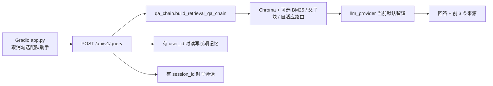
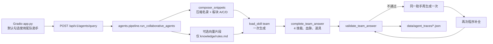

# 当前实现盘点

盘点日期：2026-10-02。范围是 `C:\Users\ADMIN\Desktop\Policy-qa` 的源码、配置、知识库文件和运行产物。未读取 `.env` 中的密钥。未展开 `.venv`、模型权重和向量库内部文件。README、`docs/项目精读-新手版.md`、`docs/洛克宠物配队-技术方案.md` 只当作作者意图；和代码冲突的地方标为「文档过时」。

## 1. 一句话现状

这是一个仍跑在政策 RAG 底座上的洛克王国配队服务：网页默认走一个配队助手，模型只选 6 只并点技能，程序补满每只 4 个技能、裁定血脉和全队唯一道具，再按规则核对；政策 PDF、混合检索和用户系统还在，但向量库这次盘点时没有可用内容，Vue、Spring Boot 和 LLaMA-Factory 都还没落地。

## 2. 真实架构图

登录不是提问的前提。Gradio 未登录也会创建 `session_id` 并调用接口。长期记忆只在请求带 `user_id` 且 `memory_manager` 导入成功时生效。对话写进 SQLite（`data/policy_qa.db`）还要用户已登录。

### A. 政策 / 通用问答

检索是 Chroma 向量，再按配置叠加 BM25、父子块、自适应路由和可选重排序。提示词已经改成配队口吻，但命中的语料仍是 `data/` 里的政策 PDF；只有在成功建库时才会把 `knowledge/rules.md` 的板块一并写入同一向量库。精灵 JSON 不进这条链。核对没有独立步骤，就是这一次 LLM 生成。

向量库未建成时，这条路径返回「没有可用的政策文档」或 503，不能靠精灵 JSON 回答。

### B. 配队

主路径不调用使用率助手、配合助手、诉求助手，也不调用 `choose_overlapping_scheme`。`load_skill("retriever")` 会执行，但检索员技能正文不进入配队提示词，也不会为此再调一次模型。检索是 `composer_snippets`：31 只的压缩名录（每只 8 到 12 个推荐技能）、板块 A、板块 C、板块 D 的三种道具短文案，以及问题里点到名的精灵的完整三池。不放入完美配队模板，也不放入 579 条技能总表或 31 份完整 `record`。`meta_snippet()` 在 `usage.json` 两个窗口都空时返回空字符串，提示词里不会出现使用率百分比。

向量片段只有在检索链已建成时才附加，并且先丢掉来源里没有 `knowledge/`、也不以 `rules.md` 结尾的片段，再丢掉正文含「完美配队模板」的片段。模型生成之后，`complete_team_answer` 补技能、血脉和道具；核对是 `validate_team_answer`，不是 `checker/SKILL.md`。补全后仍不通过，才让同一助手再生成一次，然后再补全、再核对。成功且无需重写时，轨迹里的 `llm_calls` 为 1。轨迹写到 `data/agent_traces/`。

`gold_teams.jsonl` 和技能目录里的 `usage` / `synergy` / `request` / `writer` / `checker` 都不在这条提示词路径上。空的 `usage.json` 也不进入提示词。

程序补全和校验共用 `parse_team_config`。合格正文是六行「名字｜标签｜血脉｜技能」，接着一行「战斗道具：【…】」，再是「选取的理由是……」。每只正好 4 个技能，不含【聚能】；血脉技能至多 1 个。联防位至少一个防御技能。输出位至少两个攻击技能，并且要么克制至少 4 种单属性，要么能反克会克制自己的属性；物攻和魔攻相差达到 15 时，攻击技能不能整体走反方向。覆盖率只统计这 4 个已携带技能的系别。血脉三档互斥：进化之力的恶魔狼或雪影娃娃是首领血脉，带了血脉技能就是某系血脉，否则是初始血脉。

## 3. 模块清单

### 在用

| 模块 | 职责 | 被谁调用 | 说明 |
| --- | --- | --- | --- |
| `run_api.bat` | 激活 `.venv`，运行 `python api.py`，端口 8000 | `start.bat` 选项 1、3 | 标题仍是 Policy QA API |
| `run_web.bat` | 再开一个 API 窗口，然后运行 `app.py`，端口 7862 | `start.bat` 选项 2、3 | 自己也会启动 API，见风险 |
| `start.bat` | 菜单选择只开 API、只开网页或两者 | 人工 | 选项 3 会和 `run_web.bat` 抢 8000 |
| `api.py` | FastAPI 入口 | 两个 bat、Docker | 政策问答和配队共用一个进程 |
| `app.py` | Gradio 页面 | `run_web.bat`、Docker web | 默认勾选配队助手，调用 `/agents/query` |
| `config.py` | 读 `.env`，给出模型、分块、检索开关 | 几乎所有入口 | 未在本文打印密钥 |
| `llm_provider.py` | 智谱 / DeepSeek | 问答链、配队、长期记忆 | 默认供应商 `zhipu`，模型名来自 `OPENAI_MODEL` |
| `pokemon_kb.py` | 精灵 JSON、规则分块、技能字典、压缩名录、技能栏补全、血脉和道具裁定、校验、反馈 | `agents/pipeline.py`、`api.py` 反馈、`tasks.py`、`train_*.py` | 文件头写的是洛克王国。主路径函数是 `composer_snippets`、`complete_team_answer`、`validate_team_answer` |
| `agents/pipeline.py` | 单助手一次生成、程序补全、失败再生成一次、轨迹 | `POST /api/v1/agents/query` | 函数名仍是 `run_collaborative_agents`。轨迹带 `llm_calls` |
| `agents/skill_text.py` | 读取 `SKILL.md` | pipeline、蒸馏、LoRA 复现 | |
| `agents/skills/team/SKILL.md` | 当前唯一进入配队提示词的技能 | `load_skill("team")` | 要求 6 人、4 技能、倾斜、1–3 输出、其余联防。写明血脉和道具以程序裁定为准 |
| `knowledge/pokemon/*.json` | 31 只精灵 | `load_pokemon()` | 字段见第 5 节。技能栏只从 `native_skills`、`stone_skills`、`blood_skills` 取名 |
| `knowledge/rules.md` | 板块 A–O 与技能、特性表 | `rule_chunks()`、`skill_catalog()`，以及建库时的 `load_knowledge_documents()` | 配队提示词固定取 A、C，外加 D 的三种道具短文案。板块 G 只被程序解析，不整段进入提示词 |
| `database.py` | 用户、对话、上传文档元数据 | 认证和历史接口、Gradio 登录后 | SQLite：`data/policy_qa.db` |
| `session_store.py` | 短期会话 | `/query` 与 `/agents/query` | Redis 不通时写 `data/session_store_fallback.json` |
| `memory_manager.py` | 长期记忆 | 仅当请求带 `user_id` | SQLite：`data/memory.db`。导入失败则整段关闭 |
| `document_processor.py` | PDF 解析、父子块；`load_knowledge_documents()` 只包装 `rules.md` | API 建链、`tasks.run_rebuild` | 不收录精灵 JSON，不收录 `知识库.md` |
| `vectorstore.py` / `embeddings.py` / `bm25_chinese.py` / `reranker.py` / `query_router.py` / `qa_chain.py` | 政策 RAG 检索与生成 | `/query`，以及配队在链已建成时的可选向量检索 | `qa_chain.py` 的系统提示已改成配队，语料仍是 PDF |
| `tasks.py` | 重建向量库、处理用户 PDF | `/rebuild`、用户上传 | Redis 队列不可用时 API 改在本进程重建 |
| `user_vectorstore.py` | 每个用户一个 Chroma | 上传 PDF、带 `user_id` 的检索 | |

### 半废弃

这些文件还在，主配队路径不调用它们，或只被离线脚本引用。

| 模块 | 现状 |
| --- | --- |
| `pokemon_kb.build_team_snippets` | 会读使用率、模板成员和板块 C/D/E/O。全仓库没有调用方 |
| `choose_overlapping_scheme` / `format_consensus` / `parse_schemes` | 三助手重合选队的实现还在，pipeline 已不调用 |
| `validate_team_draft` | 仍要求正文里有「【队伍】」。主路径和 `team_reward` 已改走 `validate_team_answer`。它只还被没有调用方的重合选队使用 |
| `agents/skills/usage`、`synergy`、`request`、`writer`、`checker` | 文件都在。pipeline 不 `load_skill`。`lora_reproducer.py` 仍加载 `writer`。`skill_distill.example_from_trace` 在没有 `skill_text` 且技能名是 `writer` 或为空时返回空，不再回退加载 `writer` |
| `agents/pipeline.standalone_query`、`_parse_checker` | 还在文件里，当前 `run_collaborative_agents` 不调用 |
| `knowledge/usage.json` | 有「前一天 / 上个月」两个空窗口。`meta_snippet()` 读到空窗口就返回空字符串，不进入配队提示词。`build_team_snippets` 仍会写出使用率，但没有调用方 |
| `knowledge/gold_teams.jsonl` | 2 行模板。只在反馈重建 DPO 样本时读取，不参与当前配队 |
| `knowledge/知识库.md` | 与规则同源的长稿。Python 只在 `pokemon_kb.py` 注释里提到它，没有加载 |
| `offline_evaluation.py`、`end_to_end_evaluation.py`、`test_set.json`、`EVALUATION_GUIDE.md`、`.github/workflows/ragas-eval.yml` | 政策 RAG 评测。`test_set.json` 有 50 题，抽到的题目是数字中国等政策题，不是配队题 |
| `test_retrieval_comparison.py`、`test_comparison.bat` | 比较固定混合检索和自适应检索 |
| `monitoring.py` | 自带 `monitoring.db` 和报告函数，API 主路径不引用 |
| `document_processor_mineru.py` | 仅当 `USE_MINERU=true` 时由 `api.py` 导入 |
| `document_processor_simple.py` | `api.py` 在 EasyOCR 导入失败时会导入它，仓库里没有这个文件 |
| `view_report.bat` | 调用 `view_evaluation_report.py`，该 py 文件不存在 |
| `MML12-v2/` | 只有 `config.json`、两份 tokenizer 配置、`tokenizer.json`、`vocab.txt`，没有权重。Docker 仍把它挂成模型目录 |
| `chroma_db/` | 目录存在。本次列出的顶层条目为空，不能当成已建成的向量库 |
| `bge-m3/` | 不存在。`config.py` 因此回退到远程 `BAAI/bge-m3` |

### 计划未做

`docs/洛克宠物配队-技术方案.md` 里的这些东西，仓库中没有对应实现：

- Vue 3 工程、端口 5173
- Spring Boot 工程、端口 8080
- `train/qwen1_5b_lora.yaml`、`dataset_info.json`、LLaMA-Factory
- `adapters/team-lora`
- 路由 `POST /internal/teams/build`，以及方案里的 `/api/pokemon`、`/api/teams/build`、`/api/train/export`

现有训练脚本是另一套：`train_lora.py` 用 `transformers + peft` 写 `data/lora/adapter`；`train_dpo.py` 只重写偏好对，不更新权重；`train_ppo.py` 只给最近一条轨迹打分，不更新权重。

## 4. 声称 vs 实现

| 声称来源 | 代码事实 | 差距 |
| --- | --- | --- |
| README 开头：政策 RAG，解析到重排序再到 LLM | `/query` 仍是这条链；`data/` 下有 10 个政策 PDF | 主页面默认已经不走这条链。文档过时的是「这就是产品本身」 |
| README：密码安全存储 | `database.hash_password` 是不加盐的 SHA-256 | 有哈希，没有盐，也没有独立令牌 |
| README：PDF 放到 `data/policy_pdfs/`，并调用 `build_vectorstore()` | PDF 直接在 `data/`。没有 `build_vectorstore` 函数。重建入口是 `POST /api/v1/rebuild` 和 `tasks.run_rebuild` | 文档过时 |
| README 配队节：8 只示例，可补到 30 只 | `knowledge/pokemon/` 有 31 个 JSON。`rules.md` 板块 O 写「容量 30 只。当前已记录 31 只。」 | 文档过时 |
| README：使用率是模拟数字，按统计替换 | `usage.json` 两个窗口的 `date` 都是「未提供」，`pokemon` 和 `teams` 都是空数组 | 不是模拟数字，是空数据 |
| README：网页默认三个助手，检索员取使用率，配队员写队伍，核对员查技能池 | `app.py` 默认勾选「使用配队助手」，说明文字已写成一个助手，并写明 4 技能、血脉、道具由程序校验或补全。请求 `/agents/query`。核对是 `validate_team_answer` | 文档过时。页面标题仍是「洛克宠物自动配队」 |
| README：`train_dpo.py` 只整理偏好，`train_ppo.py` 只打分，智谱不能训练 | 与 `train_dpo.py`、`train_ppo.py`、`train_lora.py` 的文件头一致 | 这一段和代码相符。真正会改权重的是 `train_lora.py`，而且要另有本地基座和 `data/lora/train.jsonl`。该 jsonl 目前不存在 |
| `docs/项目精读-新手版.md`：按政策 RAG 讲解，并指出 `view_report.bat` 指向不存在的脚本 | 政策 RAG 模块还在；`view_evaluation_report.py` 仍然不存在 | 精读描述的是底座，不是当前配队主路径。关于坏掉的 bat，仍然属实 |
| 技术方案：三个助手各出两套，再按重合选队，核对员只查被选中的一套 | `choose_overlapping_scheme` 还在 `pokemon_kb.py`，pipeline 不调用。当前是一次生成，程序补全 4 技能、血脉和道具，再校验；不通过才再生成一次 | 文档过时。它写明「不改现有代码」，但代码后来已经改了 |
| 技术方案：Vue、Spring Boot、LLaMA-Factory、`/internal/teams/build` | 路由表里没有这些路径，也没有这些工程目录 | 计划未做。方案自己也写了确认前不要创建这些工程 |
| 技术方案：知识字段含个体值 | 31 个 JSON 的键完全一致，没有 `ivs` 或「个体值」 | 文档和 README 都过时 |
| 技能目录有 retriever、team、synergy、request、writer、checker、usage | 七个 `SKILL.md` 都在。配队运行时加载的是 `retriever`（只放进轨迹）和 `team`（放进提示词） | 其余五个是残留技能 |
| 评测集覆盖当前产品 | `test_set.json` 50 条，内容是政策问答 | 不能用来验收配队 |

### 路由

| 方法 | 路径 | 实际调用 | 类别 |
| --- | --- | --- | --- |
| GET | `/api/v1/health` | 内存中的链状态 | 政策 RAG |
| POST | `/api/v1/query` | `qa_chain` 检索链 | 政策 RAG。提示词已是配队口吻 |
| POST | `/api/v1/agents/query` | `run_collaborative_agents` | 配队 |
| POST | `/api/v1/teams/feedback` | `pokemon_kb.record_feedback` | 配队 |
| POST | `/api/v1/skills/export` | `agents.skill_distill.export_dataset` | 训练 |
| GET | `/api/v1/files` | 已加载文件列表 | 政策 RAG |
| POST | `/api/v1/rebuild` | `tasks.enqueue_rebuild`，失败则本进程 `run_rebuild` | 政策 RAG |
| GET | `/api/v1/tasks/{task_id}` | RQ 任务；`local` 是本进程重建 | 政策 RAG |
| GET | `/api/v1/search` | Chroma `as_retriever` | 政策 RAG |
| POST/GET/DELETE | `/api/v1/session` 及 history | `session_store` | 用户系统 |
| POST | `/api/v1/auth/register`、`/auth/login` | `database.create_user` / `login_user` | 用户系统 |
| GET | `/api/v1/auth/user/{user_id}` | `database.get_user_by_id` | 用户系统 |
| POST/GET/DELETE | `/api/v1/users/{user_id}/documents` | `user_vectorstore`、SQLite | 用户系统 |
| POST/GET/DELETE/PUT | `/api/v1/conversations` | `database` 对话表 | 用户系统 |

没有配队专用的内部路由。所有上表接口都没有登录依赖；`user_id` 由调用方自己传入。

### 三件需要单独写明的核对

1. 三个助手已经不在主路径上。残留的是技能文件和 `choose_overlapping_scheme`。
2. 政策 PDF 不会原样进入配队提示词。`_knowledge_vector_snippets` 只保留来源含 `knowledge/` 或以 `rules.md` 结尾的命中，pipeline 再丢掉含「完美配队模板」的文本。它们仍然会和规则板块放进同一个 Chroma，一旦建库成功，`/query` 和 `/search` 会检索到它们。
3. `知识库.md` 和精灵 JSON 没有第二份向量索引。向量侧只接收 `rule_chunks()`。配队侧直接读 JSON。同一份 `rules.md` 会同时被结构化检索和向量检索使用，这是重复通道，不是两份原稿。

## 5. 数据资产

### 精灵 JSON

31 个文件，键集合完全相同：`abilities`、`base_stats`、`blood_skills`、`boss`、`can_boss`、`moves`、`name`、`native_skills`、`number`、`record`、`stage`、`stone_skills`、`style`、`trait`、`types`。没有个体值字段。

`base_stats` 的键是 `hp`、`attack`、`defense`、`special_attack`、`special_defense`、`speed`。`style` 和 `trait` 是字符串，`abilities` 是列表。抽看的 `水灵.json`、`瞌睡王.json`、`卡瓦重（雪山附近的样子）.json` 都符合这套结构；差别只在列表长度和 `boss` 是否为空字符串。

`record` 是完整中文正文。配队提示词不再附上这 31 份正文。压缩名录用 `style`、`types`、`base_stats` 的物攻和魔攻，以及从三池里挑出的 8 到 12 个推荐技能。点名精灵才附上完整三池。技能名去掉 `｜LV` 和 `｜某系血脉` 后再到板块 G 对类别、物攻或魔攻、系别。

### 规则板块

`rules.md` 的二级标题有：导读之后的 A 属性、B 能量、C 携带技能与血脉、D 战斗道具、E 对局、F 精灵记录、G 技能分类与技能总表，然后是 18 个「某系」技能分组，再是 H 状态、I 印记、J 天气、K 技能效果、L 其他术语、N 特性表、M 伤害公式、O 精灵信息、仍缺的内容。N 写在 M 前面。

`_PLATE_HINTS` 覆盖 A–E、G–O 和「仍缺」，没有 F 和 L。这张表只服务于已经没有调用方的 `retrieve_rule_chunks`。当前配队提示词固定收录板块 A、板块 C，以及板块 D 的三种道具短文案，不收录愿力冲击的威力换算，也不按问题去挑 B、E、O 或技能总表。

`skill_catalog()` 解析板块 G：每个技能有 `category`（攻击 / 防御 / 状态）、`damage`（物攻 / 魔攻 / 空）和 `types`。本次解析得到 580 条，其中 579 条来自总表，另加板块 B 的【聚能】（状态技能）。【聚能】不占 4 个技能栏。防御技能 54 条，与板块 G 写的数量一致。推荐技能每只 8 到 12 个。

### 使用率、模板、偏好、轨迹

| 资产 | 数量（本次盘点） | 谁写 | 谁读 |
| --- | --- | --- | --- |
| `knowledge/usage.json` | 2 个窗口，都没有精灵和队伍 | 人工文件 | `meta_snippet()` 发现两窗皆空就返回空字符串。`build_team_snippets` 仍会格式化使用率，但没有调用方。`team_reward` 只在窗口里真有队伍时才算重合 |
| `knowledge/gold_teams.jsonl` | 2 行 | 人工文件 | `rebuild_preference_dataset`、`template_member_names`。后者只被无调用方的 `build_team_snippets` 使用 |
| `data/preferences/interactions.jsonl` | 文件不存在 | `record_feedback` 追加 | `rebuild_preference_dataset` |
| `data/preferences/dpo.jsonl` | 文件不存在 | `rebuild_preference_dataset` 覆盖写 | `train_dpo.py` 只统计并提示，不训练 |
| `data/agent_traces/*.json` | 3 个。两个 `skill=writer` 且 `passed=false`，一个 `skill=team` 且 `passed=true` | pipeline | `train_ppo.py` 读最新一条；`skill_distill.export_dataset` 只导出 `passed=true` |
| `data/lora/train.jsonl` | 不存在 | `/skills/export` 或 `python -m agents.skill_distill` | `train_lora.py` |
| `data/lora/adapter` | 本次未发现训练产物 | `train_lora.py` | `lora_reproducer.py` |

### 向量库和缓存

- 嵌入模型：本地 `bge-m3/` 不存在，代码回退远程 `BAAI/bge-m3`。
- `chroma_db/` 存在但本次看不到已写入的集合。`api._build_chain` 只有在 `data/` 里已经解析出 PDF 时，才会把 `load_knowledge_documents()` 接上。因此一旦建库成功，同一个库里会有政策 PDF 和 `rules.md` 板块。
- 重建入口：`POST /api/v1/rebuild` → Redis RQ；连不上 Redis 时在 API 进程里调用 `tasks.run_rebuild`。全量重建会带上规则板块。只增删 PDF 的增量路径不会重写规则向量，但会把 `knowledge/rules.md` 留在 manifest 的 `source_files` 里。
- 父块和子块缓存设计为 `data/_parent_documents_cache.pkl`、`data/_documents_cache.pkl`。它们是否有效取决于指纹是否和当前分块配置一致。
- 重排序默认关（`config.py` 里 `USE_RERANKER` 默认 `False`）。`docker-compose.yml` 把同一变量默认设为 `True`。本地 `.env` 若覆盖了默认值，以环境为准；本文没有打开 `.env`。

## 6. 风险与技术债

- 命名混用。知识库正文和 `pokemon_kb.py` 模块说明写洛克王国。页面标题、`api.py` 的空库提示、`qa_chain.py` 系统提示，以及 `usage` / `synergy` / `request` / `writer` / `checker` 技能仍写洛克宠物。种族值键名沿用 HP、attack、special_attack 这一套。
- 主路径和死代码叠在一起。三助手、重合选队、`build_team_snippets` 还在仓库里，读 README 或技术方案会以为它们仍在运行。
- `team_reward` 已改用 `validate_team_answer` 和 `config_members`。新格式「队伍配置为」不会因为缺少「【队伍】」而被打成 0 分。空使用率窗口没有队伍可重合，通过的回答分数是 0.8，不是 1。`train_ppo.py` 打的仍是这个分。
- 当前 `team` 技能写明不要写使用率。五个旧技能正文仍要求按使用率配队，但配队提示词不加载它们。`usage.json` 仍是空的，没有填入假百分比。
- 道具优先级和标签人数有一道缝。`choose_battle_item` 在输出只数大于联防只数时选【愿力强化】。能通过校验的队伍最多 3 只输出，其余必须有联防，所以输出只数不会大于联防只数。【愿力强化】只会出现在标签人数本身就不合格的草稿上。不含恶魔狼、雪影娃娃且人数合格的队伍，程序会选【光合治愈】。名字包含「恶魔狼」或「雪影娃娃」时，无论输出多少，道具都是【进化之力】，这两只写成首领血脉，4 个技能里不能再有血脉技能。
- 静默或宽捕获。配队向量检索失败只记日志并退回结构化片段。长期记忆失败只记日志。`api.py` 导入 `document_processor_simple` 时，那个文件不存在，只有 EasyOCR 那条导入失败才会暴露。
- 配置默认值和配队场景不匹配。父子块、自适应检索、查询扩展、BM25 权重都是政策长文档的设置。配队主路径不依赖它们。`config.py` 与 `docker-compose.yml` 对重排序、`RETRIEVAL_K`（代码默认 3，compose 默认 10）、按章节分块的默认值不一致。
- Docker 健康检查要求 `/api/v1/health` 的 `status == "ok"`，而 `ok` 表示向量链已建成。嵌入模型下不来时，配队接口在本机仍可回答，容器里的 API 会一直不健康，web 服务也不会启动。
- 安全。密码是不加盐 SHA-256。问答、配队、反馈、重建、按 `user_id` 上传 PDF 都不校验登录令牌。上传限制是 PDF、10MB、每用户 10 个，限制在 `user_vectorstore` 的常量里，但换一个 `user_id` 就能写到对应用户目录。
- 可运行性。`view_report.bat` 指向不存在的脚本。`start.bat` 选项 3 先启动 `run_api.bat`，`run_web.bat` 又启动第二个 `python api.py`，两个进程都绑定 8000。Redis 不是提问所必需的；没有它，会话落盘，重建改在本进程执行。没有本地 `bge-m3` 时，向量库建不起来，`/query` 不可用，配队仍可用。
- 评测门禁 `.github/workflows/ragas-eval.yml` 会在 `qa_chain.py` 等文件变更时跑政策题 RAGAS。它验收的不是配队。

## 7. 建议的项目定义

下面这段可以直接放进新 README 开头。

本仓库是洛克王国 PVP 自动配队系统，底座是原来的政策文档 RAG。用户在 Gradio 页面描述想要的队伍。默认请求 `POST /api/v1/agents/query`：程序从 31 份精灵 JSON 取出压缩名录和推荐技能，并附上板块 A、C 和道具短文案，交给一个配队助手选 6 只、点技能。程序再补成每只正好 4 个可携带技能，裁定每只血脉和全队唯一战斗道具，然后检查人数、点名、倾斜、输出数量、联防、技能池、防御或攻击技能、物攻魔攻倾向、克制覆盖和是否被单一属性全克。补全后仍不通过才再叫一次模型。政策 PDF 的解析、分块、Chroma、混合检索和用户系统仍然保留，给取消配队勾选后的 `/api/v1/query` 使用。空的使用率文件、三助手重合选队、Vue、Spring Boot 和 LLaMA-Factory 不是当前运行路径。智谱接口只负责生成回答，不在这里更新权重。

## 8. 优化 backlog

### P0 澄清与收口

| 项 | 工作量 | 依赖 | 验收 |
| --- | --- | --- | --- |
| 重写 README 开头，把配队写成产品，把政策 RAG 写成底座，删掉「8 只示例」和「三个助手」 | 半天 | 无 | 新读者只看 README 就能知道默认走 `/agents/query`，以及 `/query` 仍是 PDF 检索 |
| 在技术方案文首加现状说明：重合选队已不在 pipeline 中；Vue / Spring / LLaMA-Factory 仍是计划 | 半天 | 无 | 文中不再把三助手写成「现在已经有的部分」而不加过时标记 |
| 统一面向用户的说法为洛克王国；代码标识可以暂留 `pokemon_kb` | 1 天 | 无 | 页面标题、空库提示、当前会加载的 `team` 技能不再写洛克宠物 |
| 修正启动脚本，避免 `start.bat` 选项 3 和 `run_web.bat` 各起一个 8000 端口进程 | 半天 | 无 | 一种启动方式只监听一个 API |
| 处理 `view_report.bat`：改指向现有的 `offline_evaluation_report.json` 阅读方式，或从文档中标成失效 | 半天 | 无 | 双击不会调用不存在的 py |
| 给死代码列隔离清单，先不删：`build_team_snippets`、`validate_team_draft`、重合选队、五个未加载技能 | 半天 | README 已改 | 清单写明「无调用方」，后续删除时不会误伤 `record_feedback` |

### P1 配队链路增强

| 项 | 工作量 | 依赖 | 验收 |
| --- | --- | --- | --- |
| 决定【愿力强化】是否还要保留。当前合格队伍的输出只数不会多于联防，这条优先级到不了通过的结果 | 半天 | 无 | 要么放宽人数规则使输出可以多于联防，要么从道具优先级里去掉这一档并改技能说明 |
| 决定五个旧技能是删除还是重新接上。蒸馏已不再在缺 `skill_text` 时回退到 `writer`；`lora_reproducer.py` 仍加载 `writer` | 1–2 天 | P0 | 复现脚本和导出脚本使用同一份当前 `team` 技能 |
| 把板块 E 里「六只、必须有倾斜」等仍生效的句子，从模板段落中拆开再检索，避免以后整段模板回到向量片段 | 1 天 | 无 | 配队提示词含对局约束，不含完美配队模板名单 |
| 核对缺口：同种不同形态是否算重复、愿力冲击是否要写进技能栏。技能石和血脉药已经要求写在技能括号里 | 1 天 | 无 | 技能条文和 `validate_team_answer` 对同一支队伍给出相同通过或失败 |
| 把反馈闭环跑通：页面拒绝并填写修正后能看到 `interactions.jsonl` 和 `dpo.jsonl`；导出只收录 `passed=true` 的 team 轨迹 | 1 天 | P0 奖励分 | 一次人工拒绝产生一条偏好对；空样本时训练脚本仍拒绝启动 |
| 给配队问题做一小组固定验收题，不要复用 `test_set.json` | 1–2 天 | 校验函数稳定 | 至少覆盖点名精灵、缺倾斜、输出超过 3 只、空知识库 |

### P2 架构演进

现在不要做 Vue、Spring Boot 或安装 LLaMA-Factory。技术方案里这三段必须先改文档再实现：「现在已经有的部分」仍写三助手和重合选队；`/internal/teams/build` 被说成承接当前 `/agents/query`，但该路由不存在；LoRA 学习目标仍写「被重合选中的那套方案」。

依赖关系：P2 等到 P0 完成，并且 P1 的校验、轨迹和偏好文件能稳定产生之后。

| 项 | 工作量 | 依赖 | 验收 |
| --- | --- | --- | --- |
| 改技术方案：单助手、程序核对、现有 FastAPI 路由、本地 `train_lora.py` 与 LLaMA-Factory 的差别 | 1 天 | P0 | 方案中的「当前行为」能在 pipeline 里逐条找到 |
| 本地 `bge-m3` 放到 `bge-m3/` 后再重建向量库，并确认政策 PDF 仍被配队过滤 | 1 天，含下载 | 磁盘和网络 | `/health` 的链为就绪；配队来源里没有政策 PDF 文件名 |
| 有通过核对的轨迹后，才用现有 `train_lora.py` 做一次小步数试验 | 1–2 天 | GPU 或明确接受 CPU 只做格式检查；`train.jsonl` 非空 | 适配器目录出现；脚本没有去训练智谱接口模型 |
| 再评估是否把 Gradio 换成 Vue、把用户数据换成 Spring | 单独立项 | 上面三项 | 浏览器仍只通过一个业务入口配队，配队规则仍在 Python 侧 |

## 9. 下一步只做一件事

先改 README 的开头和配队一节，让它描述现在的单助手、31 只精灵、每只 4 个技能、程序裁定的血脉和唯一道具，并把政策 RAG 标成底座。原因是后面的优化都会被旧文档带回到三个助手和 Vue/Spring；代码已经不是那样运行的。
