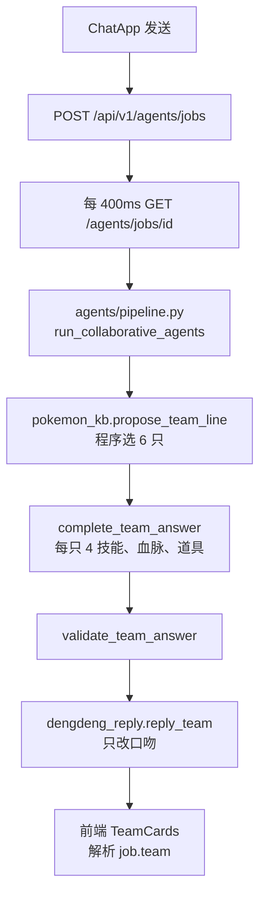
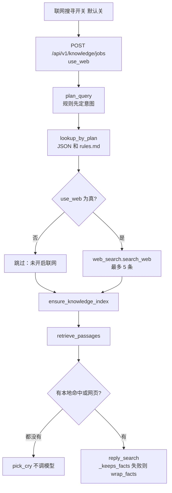
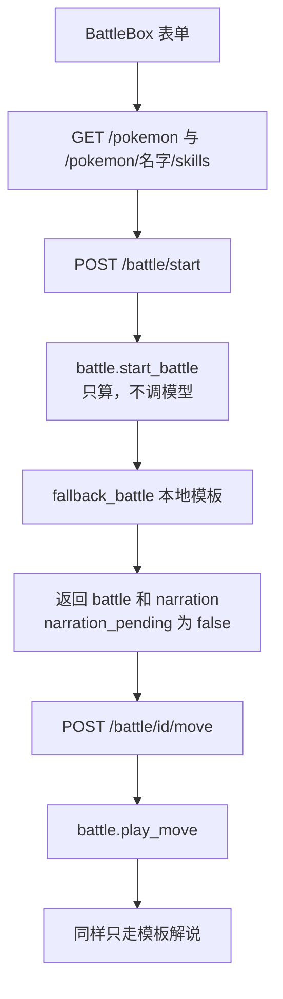
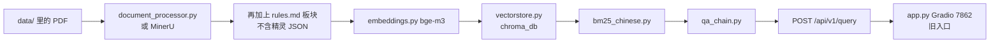

# 新手复现指南

根据源码生成的日期：2026-10-05。只对照当时的源码和 `.env.example`。

下面三份文档不要当成现状：

| 文件 | 过时说法 | 源码现状 |
| --- | --- | --- |
| `README.md` | 正式界面是 Vue 3；正文主体仍是政策问答 | 正式界面是 `web/` 的 React 19。政策问答还在，但不是 5173 的主路径 |
| `docs/项目精读-新手版.md` | 网页是 Gradio `7862`，提问走 `POST /api/v1/query` | `run_web.bat` 打开的是 `5173`。主路径是配队任务、检索任务、对战接口 |
| `docs/洛克宠物配队-技术方案.md` | 方案未落地：LLaMA-Factory、Spring Boot、Vue 3、三个助手投票选队 | 这些都没进运行路径。选人在 `pokemon_kb.propose_team_line`，成文 LoRA 用 `train_lora.py` + PEFT，不是 LLaMA-Factory |
| `docs/当前实现盘点.md` | 盘点日 2026-10-02。写 Gradio 默认勾选配队、模型点 6 个名字、Vue 未落地 | 之后已换成 React。配队不再等模型选人。对战解说不再同步等大模型 |

在 Cursor 里用搜索跳到函数名，用终端跑文末命令。不要把本指南里的「当前行为」记成某份旧文档的句子。

## 读完应能回答的四件事

1. 5173 检索信息的主路径是 `knowledge_search.run_knowledge_search`，不是 `qa_chain`。
2. 配队不是大模型挑人。程序 `propose_team_line` 选出 6 只，`complete_team_answer` 补技能、血脉、道具。灯灯只改口吻。
3. LoRA 的损失只优化助手回答那段 token。`train_lora._mask_labels` 把提示词位置的 label 设成 `-100`，训练时忽略。
4. 改 `.env` 的 `BM25_WEIGHT` 不会改变 5173 上「结构化检索」的结果。那一步只读 JSON 和 `rules.md`。权重只在政策向量链，或检索专用向量索引真的建成之后，才参与混合检索。默认机器没有本地 bge-m3，这两步会跳过，所以改了也看不见。

## 阅读顺序

1. 第 1 章：这套系统现在是什么。
2. 第 2 章：浏览器上的四条链路。
3. 第 3 章：RAG 怎么配。新手重点。
4. 第 4 章：`web/` 每个文件干什么。
5. 第 5 章：灯灯 LoRA 怎么采、怎么训、怎么用。
6. 第 6 章：文件总表。
7. 第 7 章：按天复现。

专有词第一次出现时解释。后面直接用简称。

---

## 1. 这套系统现在是什么

给人用的页面在 `web/`。技术栈是 React 19、Vite、Tailwind CSS、lucide-react。浏览器地址是 `http://127.0.0.1:5173`。

接口在 `api.py`，FastAPI，地址是 `http://127.0.0.1:8000`。Vite 把以 `/api` 开头的请求转发到 8000。

页面上有三种模式：智能配队、检索信息、模拟对战。精灵资料在 `knowledge/pokemon/*.json`。规则和技能总表在 `knowledge/rules.md`。

同一仓库里还留着更早的政策问答。那是 RAG。RAG（Retrieval-Augmented Generation，检索增强生成）的意思是：先从文档里找出相关段落，再让模型根据这些段落写答案，而不是让模型凭记忆编。政策这条链的入口是 `POST /api/v1/query` 和 Gradio 的 `app.py`（默认端口 7862）。它们还能跑，但不是打开 5173 之后的主路径。

启动时 `api.py` 的 `lifespan` 只建目录和数据库。日志写「向量问答链等真正提问时再加载」。它不会在启动时调用 `_ensure_chain`，所以不会一开机就下载嵌入模型。

没有政策 PDF，洛克王国助手仍然能跑。配队、检索、对战都读 `knowledge/`，不读 `data/` 里的 PDF。

---

## 2. 四条链路

### A. 打开页面


这一跳用到的文件：`web/vite.config.js`、`web/src/main.jsx`、`web/src/App.jsx`、`web/src/components/AuthScreen.jsx`、`web/src/components/ChatApp.jsx`、`web/src/api.js`、`api.py` 的 `/api/v1/auth/*`、`database.py`。

游客点进去时 `userId` 是 `null`。`ChatApp` 发请求时，没有 `userId` 就不带 `user_id`。游客聊天记在浏览器 `sessionStorage`，键名 `roco-guest-chats`。登录用户的历史走 `/api/v1/conversations`。

密码至少 6 位。`database.py` 用无盐 SHA-256 存哈希。改密码是 `POST /api/v1/auth/change-password`。

### B. 智能配队



这一跳用到的文件：`web/src/components/ChatApp.jsx`、`web/src/components/TeamCards.jsx`、`web/src/api.js`、`api.py` 的 `create_agent_job` / `_execute_team` / `_team_cards`、`agents/pipeline.py`、`pokemon_kb.py`、`agents/dengdeng_reply.py`、`agents/dengdeng_persona.py`。

`TEAM_USE_VECTOR` 默认 `false`。`_team_retriever` 在它为 false 时直接返回 `None`，配队不建向量库。`run_collaborative_agents` 也不把检索器传进去。

选人规则在 `propose_team_line`：点名的精灵先入队；尽量带一只会倾斜的；输出不超过 3 只；其余按问题里的防守或输出偏向打分。人不够 6 只时返回空，接口会 503，提示把 JSON 放进 `knowledge/pokemon/`。

口吻包装只在核对之后。`reply_team` 要求回答里仍能对上 6 个名字、血脉、4 个技能和道具（`team_keeps_roster`）。对不上就回退 `fallback_team`。卡片数据来自程序名单 `roster`，不从口吻散文里猜。

前端创建任务超时 12 秒，轮询单次 8 秒，整段最多等 180 秒。`api.js` 默认超时是 15 秒。配队任务在内存里，1800 秒过期。

`pipeline.py` 会 `load_skill("team")` 和 `load_skill("retriever")`，正文写进轨迹文件 `data/agent_traces/`，不拿来选人。`standalone_query` 才会用检索员技能调模型，产品配队不调用它。`writer`、`checker`、`usage`、`synergy`、`request`、`search` 这些 `SKILL.md` 不在这条路径上。

### C. 知识检索



这一跳用到的文件：`web/src/components/ChatApp.jsx`、`web/src/components/RagFlow.jsx`、`knowledge_search.py`、`pokemon_kb.py`、`web_search.py`、`agents/dengdeng_reply.py`、`qa_chain.build_retriever`（仅索引那一步）、`vectorstore.py`。

步骤条七步，定义在 `KNOWLEDGE_STEPS`：理解意图、结构化检索、联网搜寻、知识索引、召回片段、生成回答、合并结果。`RagFlow` 把 `skip` 显示成「跳过」。

意图由 `plan_query` 决定。`_plan_by_rules` 能定下来时，不调用模型。规则顺序是：问句里点到已记录名字 → `lookup_one`；点到技能名 → `lookup_skill`；有属性且提到技能 → `skills`；有属性且像推荐 → `recommend`；有属性 → `list`；点到板块 → `rules`；问防御减伤 → `mechanic_defend`；同时出现「打断」和「状态」→ 查「截拳」。

只有规则结果是 `unknown`，并且 `allow_model=True` 时，才调用 `_plan_with_model`。那次调用只要求模型输出意图 JSON，超时用 `get_team_invoke()` 的默认 45 秒。同步接口 `search_knowledge` 传 `allow_model=False`，永远不规划模型。页面走的是 jobs，所以 `run_knowledge_search` 传的是 `True`。

这些意图的查找本身都不调模型：`lookup_one`、`list`、`recommend`、`lookup_skill`、`mechanic_defend`、`rules`、`skills`。它们只读 JSON 和 `rules.md`。

源码里有 `if plan.get("intent") == "matchup"`，但 `_plan_by_rules` 和 `_plan_with_model` 都不会产出 `matchup`。问「水灵对战某精灵，谁赢」时，因为点到了名字，意图是 `lookup_one`，会各写一份摘要，不会单独走胜负分支。`_search_accept` 里对「更可能获胜」「不是模拟赛」的检查，只在结构化摘要里已经有这两句时才生效。当前摘要函数 `_elf_summary` 不写这两句。

有命中时，`_generate_answer` 总会走灯灯成文，不再因为 `need_rag=false` 跳过。成文要过 `_search_accept`：必须自称灯灯、称呼小洛克、不能有 Markdown 井号标题和代码围栏、必须保住资料里的名字和数字。`双灯鱼` 在必须提到的名字里时，回答不能出现「首领化」。失败则 `wrap_facts`，把程序摘要包成口语。本地和网页都没有时，`pick_cry()`，不调用模型。你会看到「知识量还不够」这类句子。

联网只在检索模式、且开关为真时把 `use_web: true` 放进请求。关着就报告「未开启联网」，不调用 `search_web`。开了但 `WEB_SEARCH_API_KEY` 为空，跳过并在答案末尾加上「未配置搜索密钥，本次没有联网。」网页只当背景。种族值和技能效果仍以本地命中为准。采用的网页列在文末「来源」下面，格式是「标题｜url」。

知识索引和召回是加分项。`ensure_knowledge_index` 把 `rules.md` 切块和每只精灵一条摘要写到 `data/knowledge_index`。嵌入模型加载失败时记「向量库未就绪」，两步都跳过，答案仍用结构化结果。索引已在内存里时，索引步显示「复用已有索引」，状态也是跳过，意思是不用重建。

前端轮询间隔 400 毫秒，整段截止 180 秒。知识任务同样在内存里，1800 秒过期。

### D. 模拟对战



这一跳用到的文件：`web/src/components/BattleBox.jsx`、`web/src/ui/Portrait.jsx`、`api.py` 的 `battle_start` / `battle_move` / `_battle_narration`、`battle.py`、`photos.py`、`agents/dengdeng_persona.py` 的 `fallback_battle`。

现状：开战和出招先结算，再立刻用本地模板解说。`_battle_narration` 只调用 `fallback_battle`。注释写明不加载 LoRA，也不等云端 teacher。`reply_battle` 还在 `dengdeng_reply.py` 里，产品这两条接口不调用它。所以不会在对战请求里同步等 120 秒模型。

`/battle/start` 和 `/battle/move` 的前端超时是 20 秒。拉名单和技能仍用 `api.js` 默认 15 秒。

对战存在进程内存，1800 秒过期。伤害在 `battle.py`，不调模型。每边恰好 4 个不同技能，不能把「聚能」放进这 4 栏。聚能是单独按钮。道具只允许愿力强化、进化之力、光合治愈。血脉技能最多一个。初始血脉和首领血脉不能再带血脉技能。系别血脉技能的系必须对上。`can_boss` 只有资料里写「是」才为真。

道具不占回合。愿力强化不是立刻造成伤害，它把第一栏换成愿力冲击。进化之力按当前生命比例换到首领形态。光合治愈的持续回复只在真正的技能或聚能回合结束时跳。

一键配招只填表，不开战。它随机两只不同精灵（名录不足两只时可以相同），各抽 4 个不含聚能的技能，血脉优先「某系血脉」或初始血脉，只有 `can_boss` 且小概率才选首领血脉，道具在三种里随机。

### E. 旧政策 RAG



这一跳用到的文件：`app.py`、`api.py` 的 `query` 与 `_build_chain`、`document_processor.py`、`document_processor_mineru.py`、`embeddings.py`、`vectorstore.py`、`bm25_chinese.py`、`reranker.py`、`query_router.py`、`qa_chain.py`、`llm_provider.py`。

`TEAM_USE_VECTOR` 只管配队要不要附带政策检索器。默认关。它和检索信息不是同一个开关。

两套向量目录：

| 目录 | 谁建 | 装什么 |
| --- | --- | --- |
| `chroma_db/`（`PERSIST_DIRECTORY`） | `_build_chain`，给 `/query` 和 Gradio | 政策 PDF 分块，再加上 `rules.md` 板块。不含精灵 JSON，不含整份 `知识库.md` |
| `data/knowledge_index/` | `knowledge_search.ensure_knowledge_index` | `rules.md` 切块，外加每只精灵一条 JSON 摘要 |

它们不是同一套库。改 `BM25_WEIGHT` 会影响政策链；检索专用索引若建成，`build_retriever(..., adaptive=False)` 也会读这个权重。5173 的结构化查找不读它。

`qa_chain.py` 的 `QA_PROMPT` 第一句是「你是洛克宠物配队助手」。那是政策 `/query` 的提示词，和 5173 检索信息里的灯灯 `SYSTEM` 不是同一条。同文件的历史改写提示仍用海运、增值税的例子。

---

## 3. RAG 配置过程

按建造顺序读。5173 的检索信息多数时候用不到第 3 到第 5 步。那些步骤是政策旧链，以及检索专用索引的可选项。

### 3.1 原料

| 路径 | 谁读 | 读成什么 | 不放会怎样 |
| --- | --- | --- | --- |
| `knowledge/pokemon/*.json` | `pokemon_kb.load_pokemon` | 每只一个字典：名字、属性、特性、种族值、技能池、`can_boss`、`record` | 配队 503；检索查不到这只；对战名单里没有它 |
| `knowledge/rules.md` | `pokemon_kb` 的规则、技能总表、属性克制 | 板块文本和技能行 | 技能效果、伤害规则、克制表空 |
| `knowledge/知识库.md` | 没有 Python 打开它 | 人类原稿 | 删了不影响接口。不要把它和 JSON 再索引一遍 |
| `knowledge/usage.json` | `pokemon_kb` 使用率窗口 | 两个窗口，当前样本是空列表 | 配队不出现使用率百分比 |
| `knowledge/gold_teams.jsonl` | 偏好数据、`train_dpo.py` | 完美配对行 | 不影响 5173 当场配队 |
| `data/*.pdf` | `document_processor.load_and_split_pdfs` | LangChain `Document` 列表 | 政策 `/query` 没有文档。洛克三模式仍可跑 |

精灵 JSON 同构，一只一份。以 `knowledge/pokemon/双灯鱼.json` 为例：`name`、`number`、`types`（水、电）、`trait`（对流）、`can_boss` 为「否」、`style`（输出、联防、充能）、`base_stats` 六项、`moves`、`native_skills`、`stone_skills`、`blood_skills`、`record`。检索摘要用这些字段，不把 `知识库.md` 再抄一遍。

在 Cursor 里搜索 `def load_pokemon` 和 `def _elf_summary`。

### 3.2 开关

配置在 `config.py`，启动时 `load_dotenv` 读项目根目录 `.env`。改完必须重启 `api.py`。下表「默认」是代码里的值。`.env.example` 没写的项，改 `.env` 仍然有效，只要代码用了 `os.getenv`。

| 变量 | 默认 | 改了影响哪一步 |
| --- | --- | --- |
| `ZHIPU_API_KEY` | 空则启动校验失败 | 配队口吻、检索成文、意图规划、政策 `/query` 的云端模型 |
| `ZHIPU_BASE_URL` | `https://open.bigmodel.cn` | 智谱地址 |
| `LLM_PROVIDER` | `zhipu` | `zhipu` 或 `deepseek` |
| `OPENAI_MODEL` | `glm-4-flash` | 智谱模型名 |
| `DEEPSEEK_API_KEY` / `DEEPSEEK_BASE_URL` / `DEEPSEEK_MODEL` | 密钥空；地址 `https://api.deepseek.com`；模型 `deepseek-chat` | 仅当供应商是 deepseek |
| `LLM_TIMEOUT` | 60 | 政策 `/query` 那次调用 |
| `LLM_MAX_RETRIES` | 3 | 政策链重试。配队口吻函数自己把重试收成 1 |
| `TEAM_LLM_TIMEOUT` | 45 | 意图规划，以及没单独加长的 `get_team_invoke()` |
| `TEAM_LLM_MAX_RETRIES` | 1 | 配队相关调用 |
| `VOICE_LLM_TIMEOUT` | 120，且不会低于 `TEAM_LLM_TIMEOUT` | 灯灯 teacher 成文。`.env.example` 未列出，代码读环境变量 |
| `TEAM_USE_VECTOR` | false | 只有 true 时配队才尝试政策检索器。默认不加载 bge |
| `USE_LORA_REPLIER` | false（`.env.example` 也是 false） | true 且 adapter 存在时，检索和配队的成文先走本地 LoRA |
| `WEB_SEARCH_API_KEY` | 空 | 空则联网步跳过 |
| `WEB_SEARCH_ENGINE` | `tavily` | 还可 `bing`、`bravesearch` |
| `WEB_SEARCH_ENDPOINT` | 空 | 空则用该引擎官方地址 |
| `DATA_DIR` | `data` | PDF、会话兜底、`knowledge_index` 的父目录 |
| `PERSIST_DIRECTORY` | `chroma_db` | 政策 Chroma。Chroma 是存放向量的本地库 |
| `REDIS_URL` | `redis://localhost:16379/0` | 会话和重建队列。连不上时会话改写磁盘 |
| `SESSION_TTL` | 3600 | 会话秒数 |
| `USE_MINERU` | false | true 时 PDF 改走 `document_processor_mineru.py` |
| `USE_PARENT_CHILD` | true | 政策分块用父子块。父块给模型看，子块用来检索 |
| `PARENT_CHUNK_SIZE` | 2000 | 父块字数 |
| `CHILD_CHUNK_SIZE` | 500 | 子块字数 |
| `CHILD_CHUNK_OVERLAP` | 50 | 子块重叠 |
| `USE_METADATA_AUGMENT` | true | 给块加章节等元数据 |
| `USE_KEYWORD_EXTRACT` | true | 从块里抽关键词 |
| `CHUNK_BY_SECTION` | false | 不用父子块时，按章节切 |
| `USE_ADAPTIVE_RETRIEVAL` | true | 政策链按问题类型调权重。检索专用索引调用时传了 `adaptive=False`，不走这套 |
| `USE_QUERY_EXPANSION` | true | 自适应检索里扩展查询词 |
| `RETRIEVAL_K` | 3 | 交给模型的段落条数 |
| `BM25_WEIGHT` | 0.5 | 词面检索权重。BM25 是按词频匹配的算法，不像向量那样比「意思像不像」 |
| `VECTOR_WEIGHT` | 0.5 | 向量检索权重。代码会警告两者之和不是 1 |
| `USE_RERANKER` | false | true 才加载重排序模型 |
| `RERANKER_MODEL` | `BAAI/bge-reranker-base` | 重排序模型名 |
| `RERANKER_TOP_K` | 5 | 留下几条 |
| `RERANKER_THRESHOLD` | 0.0 | 分数门槛 |
| `EMBEDDING_MODEL` | 不在 `.env` 里 | 有目录 `bge-m3/` 就用本地，否则用远程名 `BAAI/bge-m3` |

注意：`.env.example` 写了 `CHUNK_SIZE` 和 `CHUNK_OVERLAP`，但 `config.py` 把这两个写成固定数 500 和 50，没有 `os.getenv`。只改 `.env` 里这两项不会生效。要改就改 `config.py` 里的赋值。指纹 `compute_build_fingerprint` 用的是这两个固定数。

5173 检索主产品在结构化查找阶段不进入 `qa_chain`。只有索引步成功时才会 `import qa_chain.build_retriever`。

### 3.3 解析与分块

`document_processor.py`：`load_and_split_pdfs` 读 `data/` 的 PDF。扫描件走 EasyOCR（`_ocr_pdf`）。`split_by_section` 按章节。`split_parent_child` 做父子块。`load_knowledge_documents` 只把 `rules.md` 板块收进来。

`document_processor_mineru.py`：仅当 `USE_MINERU=true` 且导入成功。`api.py` 的 `_build_chain` 在导入失败时退回普通处理器。

在 Cursor 里搜索 `def load_and_split_pdfs` 和 `def load_knowledge_documents`。

### 3.4 向量

`embeddings.py` 的 `create_embeddings`：HuggingFace 的 bge-m3，`normalize_embeddings=True`，注释写 1024 维。

`vectorstore.py` 的 `build_or_load_vectorstore`：文档为空就按 `manifest.json` 加载已有集合。`fingerprint` 和 `compute_build_fingerprint()` 不一致时不能当同一套库继续用，需要重建。两个集合名交替写，切换前旧集合还在。

`cache_utils.py`：文档缓存和指纹边车，避免分块参数变了还用旧缓存。

`scripts/download_bge_m3.py`：把 `BAAI/bge-m3` 下到项目里的 `bge-m3/`。可设 `HF_ENDPOINT=https://hf-mirror.com`。日常启动 API 若设了 `HF_HUB_OFFLINE=1`，缺本地模型时不会下载，向量步会失败并跳过。这是预期行为，不是检索主功能坏了。

### 3.5 混合检索

`bm25_chinese.py`：中文 jieba 分词后的 BM25。

`reranker.py`：`USE_RERANKER` 为 false 时不加载。

`query_router.py`：自适应检索的分类和查询扩展。检索专用索引那次调用关掉了它。

`qa_chain.py`：`create_history_aware_retriever` 会把多轮对话改写成检索词。生成时带引用要求。提示词和灯灯检索不是同一套，见第 2 章 E。

### 3.6 洛克检索和残留副本

活文件是 `knowledge_search.py` 加 `pokemon_kb.py`。查找优先结构化。向量是后面的加分项。

`dengdeng_kb.py` 是把 `pokemon_kb.py` 的名字改掉后留下的副本，路径指向 `knowledge/dengdeng`。全仓库没有别的 `.py` import 它。不要把它当成图鉴。活图鉴仍是 `pokemon_kb.py`，目录是 `knowledge/pokemon/`。

### 3.7 用户文档和长期记忆

`user_vectorstore.py`：登录用户上传的 PDF 另建一份向量。接口是 `POST /api/v1/users/{user_id}/documents`。React 页面没有上传按钮。

`memory_manager.py`：有 `user_id` 且模块导入成功时，政策 `/query` 和配队请求会读长期摘要。游客不带 `user_id`，不会写。5173 的聊天记录本身不靠它。登录用户用的是 `database.py` 的对话表。

`session_store.py`：短期会话。Redis 不通就写 `data/session_store_fallback.json`。Gradio 和 API 的 `session_id` 用它。React 配队请求可以带 `session_id`，但页面主历史不靠这个文件。

结论：长期记忆和用户 PDF 接到了 API，没有接到 5173 主界面。Gradio `app.py` 仍有上传和会话。

### 3.8 重建，以及没有向量库时怎样

政策库重建：`POST /api/v1/rebuild?force=false`。`api.py` 的 `rebuild_knowledge_base` 能排队就走 `tasks.py` 的 RQ，Redis 不可用就在本进程重建。进度看 `GET /api/v1/tasks/{task_id}`。

终端里也可以等 API 起来后用文档页 `http://127.0.0.1:8000/docs` 点这个接口。不要在启动命令里加预加载。

没有 `chroma_db` 时，`POST /api/v1/query` 会在 `_ensure_chain` 里失败，返回 503 一类错误，不能改用精灵 JSON 顶上。

没有 `data/knowledge_index` 且 bge 加载失败时，5173 检索不会失败。`run_knowledge_search` 把索引和召回标成跳过，生成仍用结构化命中。没有命中也没有网页时不调用生成模型，直接哭腔。

---

## 4. 前端怎么写

### 4.1 栈和启动

`web/package.json` 的脚本：`npm run dev` 即 `vite --host 127.0.0.1 --port 5173`。`npm run build` 出静态文件。`npm run preview` 预览构建结果。

`web/vite.config.js`：插件是 React 和 Tailwind。`server.proxy` 把 `/api` 转到 `http://127.0.0.1:8000`。页面写 `/api/v1/...` 即可，不用写 8000。

依赖：`react`、`react-dom` 19，`lucide-react`，开发依赖 `vite` 6、`tailwindcss` 4、`@tailwindcss/vite`、`@vitejs/plugin-react`。

### 4.2 用户点下去之后

1. `AuthScreen`：注册、登录或游客。成功后 `App` 把 `{kind, username, userId}` 写入 `sessionStorage` 的 `roco-auth`。
2. `ChatApp` 三种模式。配队和检索走任务加轮询。对战不显示输入框，改渲染 `BattleBox`。
3. 检索模式旁边有「联网搜寻」。默认关。只有这一模式会把开关传给后端。
4. 头像：`ChatBubble` 按心情选 `photo/user.png`、`photo/dengdeng.png`、`photo/dengdeng_thinking.png`、`photo/dengdeng_crying.png`。地址经 `photoUrl`，也就是 `GET /api/v1/photo/{名字}`。`photos.py` 的 `form=base` 不加查询串。`form=boss` 先找 `名字_首领化.png`。
5. 心情不进服务器正文。思考中用思考句；空回复、失败、超时、哭腔句用哭脸；对战日志用普通脸。

### 4.3 每个源文件

| 文件 | 职责 | 被谁调用 | 不调用会怎样 |
| --- | --- | --- | --- |
| `web/src/main.jsx` | 挂载 React，安装光标 | `index.html` | 白屏 |
| `web/src/App.jsx` | 读登录态，未登录显示登录页 | `main.jsx` | 进不了聊天 |
| `web/src/api.js` | `api()` 默认 15 秒超时；`photoUrl`；`parseTeam` | 各组件 | 请求和立绘地址散掉 |
| `web/src/answerText.js` | 去掉井号标题，把【标题】、粗体、列表、链接画成安全节点 | `BubbleText` | 回答里的标题样式丢失 |
| `web/src/components/AuthScreen.jsx` | 登录注册改密和游客 | `App` | 没有入口 |
| `web/src/components/ChatApp.jsx` | 模式、轮询、联网开关、历史 | `App` | 没有三模式 |
| `web/src/components/ChatBubble.jsx` | 气泡、头像、心情 | `ChatApp` | 消息没有头像 |
| `web/src/components/BubbleText.jsx` | 渲染 `answerText` | `ChatBubble` | 正文无法排版 |
| `web/src/components/TeamCards.jsx` | 画 6 人卡片 | `ChatBubble` 在 `team` 有值时 | 只剩口吻，没有卡片 |
| `web/src/components/BattleBox.jsx` | 战前表单、一键配招、战场 | `ChatApp` 对战模式 | 不能打 |
| `web/src/components/RagFlow.jsx` | 七步卷轴 | `ChatApp` 检索模式 | 看不到跳过原因 |
| `web/src/ui/GameIcon.jsx` | `/ui/${id}.png`，失败改用 Lucide | `IconButton`、`RagFlow` | 缺图时会裂图 |
| `web/src/ui/IconButton.jsx` | `icon-` 开头是贴纸，否则是圆钮 | 各按钮 | 按钮样式散掉 |
| `web/src/ui/Portrait.jsx` | 立绘。失败用 Lucide 的 PawPrint | `BattleBox` | 缺图时裂图 |
| `web/src/ui/Frame.jsx` | 木框容器 | 表单和登录 | 只是少一层框 |
| `web/src/ui/cursors.js` | 探测光标 png，没有就用备用图 | `main.jsx` | 用系统光标 |
| `web/src/index.css` | Tailwind 主题色、壁纸、贴纸 | `main.jsx` | 没有游戏外观 |
| `web/public/ui/` | 界面切图。说明在 `web/public/ui/README.md` | `GameIcon` | 自动换成 Lucide |
| `web/index.html` | 挂载点 `#app` | Vite | 没有根节点 |

立绘目录是仓库根的 `photo/`，不是 `public/ui`。UI 切图只放 `web/public/ui`。一键配招的文件名是 `icon-yijianpeizhao.png`（连字符）。`photo/icon_yijianpeizhao.png` 是素材副本，页面不读它。

---

## 5. 灯灯 LoRA

### 5.1 先定性

LoRA（Low-Rank Adaptation，低秩适配）是在大模型旁边加一小层可训练权重，不改全部参数。这里的产物叫 adapter（适配器），目录是 `data/lora/adapter`。

Teacher（老师）是云端 API：智谱或 DeepSeek。它没有可训练权重，不能对 API 模型做 LoRA。Student（学生）是本地 `Qwen/Qwen2.5-1.5B-Instruct`。学生只学一件事：给定已经查好的上下文，用灯灯的口吻说出来。

它不学图鉴，不选人，不算伤害。图鉴仍在 JSON。选人仍在 `propose_team_line`。伤害仍在 `battle.py`。

### 5.2 数据

`agents/lora_collect.py` 的 `build_questions` 用现有图鉴拼问题：每只的属性、介绍、若干技能、板块问法、两两「谁最可能获胜」、若干配队句、固定无资料题。`collect` 先跑程序得到事实，再让 teacher 只改口吻。通过的进 `data/lora/passed.jsonl`，再拆成 `train.jsonl` 和 `eval.jsonl`。失败进 `rejected.jsonl`。无资料题只进评测，不进训练。默认 `use_web` 为 false。每行 `messages` 是 system、user、assistant。

不要用 `agents/skill_distill.py` 和 `lora_reproducer.py` 当产品数据。那是旧撰写员：从 `writer/SKILL.md` 抽步骤，再复现回答。`skill_distill.py` 还会往同一个 `data/lora/train.jsonl` 写，和灯灯样本格式不同。产品推理不加载它们。

### 5.3 训练函数

在 Cursor 里打开 `train_lora.py`。

`_load_examples(path)`：读 jsonl，一行一个对象。输入路径，输出字典列表。这样训练脚本不关心采集细节。

`_mask_labels(tokenizer, messages, max_length)`：用聊天模板把「除最后一条以外」编成提示词，把完整对话编成整段。整段超过 `max_length` 会截断。然后把提示词那一段的 label 设成 `-100`。PyTorch 交叉熵会忽略 `-100`，所以损失只落在助手回答的 token 上。若截断后整段都是 `-100`，这条样本丢掉。输入是消息和长度，输出是 `input_ids`、`attention_mask`、`labels`，或 `None`。

`LoraConfig`：`r=8`，`lora_alpha=16`，`lora_dropout=0.05`，`bias="none"`，`task_type="CAUSAL_LM"`，`target_modules` 只有 `q_proj` 和 `v_proj`。秩小、只改注意力的两块投影，是为了 8GB 显存放得下 1.5B。

`Trainer` 和 `TrainingArguments`：`per_device_train_batch_size=1`，`gradient_accumulation_steps` 默认 8，`learning_rate` 默认 `2e-4`，`max_length` 默认 1536，`epochs` 默认 3（实现上换成 `max_steps`）。有 CUDA 时 `fp16=True` 且 `gradient_checkpointing=True`。`save_strategy="no"`，训完 `save_pretrained` 到 `--output`，默认 `data/lora/adapter`。基座名里带 7B 会直接拒绝。

8GB 显存仍 OOM 时，按这个顺序改，不要改成 7B：把 `--max-length` 降到 1280 或 1024；保持 batch 为 1；不要关掉梯度检查点；不要加大 `r`。CPU 可以冒烟，正式评测必须在 GPU 上重跑。下载基座时不要设 `HF_HUB_OFFLINE`。镜像用 `HF_ENDPOINT=https://hf-mirror.com`。

效果：小模型会按 `SYSTEM` 用灯灯的口气说话。它不保证事实。所以推理侧用 `_keeps_facts`（检索）、`team_keeps_roster`（配队）、`battle_keeps_log`（对战评测和 `reply_battle`）。失败先回 teacher，再回模板。对战产品接口连这条链都不走。

### 5.4 推理和评测

`agents/lora_replier.py`：第一次 `generate` 才加载。`do_sample=False`，只解码新 token。没有 `adapter_config.json` 就抛错，由上层回退。

`agents/dengdeng_reply.compose`：若 `USE_LORA_REPLIER` 为真，先 LoRA，`soften` 后交给 `accept`；不过则 teacher；再不过则 `fallback`。返回 `{text, via}`，`via` 是 `lora`、`teacher` 或 `fallback`。检索在摘要为空时直接 `pick_cry`，不进 `compose`。

`agents/dengdeng_persona.py`：唯一的 `SYSTEM` 和 `build_search_user`、`build_team_user`、`build_battle_user`。`soften` 去掉念稿腔。配队标签改说成更能挡住、更会撕咬、能充能量，不说「标签为」。

`eval_lora.py`：同一批 `data/lora/eval.jsonl`，分三次加载基座、LoRA、teacher，写出 `data/lora/eval_report.md`。列是事实保留、自称灯灯且称呼小洛克、是否出现 `##`、配队名单是否齐、平均延迟。没跑过的不要编百分比，以那份报告为准。

`train_dpo.py`：只把偏好对写成 `data` 下的 jsonl，打印条数。不更新任何权重。

`train_ppo.py`：只给最近一次配队轨迹打 `team_reward`。不更新权重。

### 5.5 可复制命令

采集（需要云端密钥，会花时间和额度）：

```bat
set PYTHONIOENCODING=utf-8
.\.venv\Scripts\python.exe -m agents.lora_collect
```

训练（需要 NVIDIA GPU 和已下载的 1.5B；这一步不要设 `HF_HUB_OFFLINE`）：

```bat
set PYTHONIOENCODING=utf-8
set HF_ENDPOINT=https://hf-mirror.com
.\.venv\Scripts\python.exe train_lora.py
```

评测：

```bat
set PYTHONIOENCODING=utf-8
set HF_ENDPOINT=https://hf-mirror.com
.\.venv\Scripts\python.exe eval_lora.py
```

打开产品里的 adapter：在 `.env` 写 `USE_LORA_REPLIER=true`，确认 `data/lora/adapter/adapter_config.json` 存在，重启 API。没有 GPU 时，采集仍可跑（它走云端 teacher）。训练和评测在 CPU 上只是冒烟，不要把 CPU 的延迟和正确率写成正式结果。没有 adapter 时，检索和配队会自动走 teacher，再走模板。

---

## 6. 文件总表

类别：产品、RAG旧链、训练、残留、文档、脚本。复现「必须」指 Day1 能打开三模式。LoRA 和政策 RAG 另算。

### 6.1 顶层 Python

| 路径 | 类别 | 做什么 | 复现必须 |
| --- | --- | --- | --- |
| `api.py` | 产品 | HTTP 入口。配队、检索、对战、登录、立绘。也挂着政策 `/query` | 是 |
| `app.py` | RAG旧链 | Gradio 7862。旧网页 | 否 |
| `config.py` | 产品 | 读 `.env`，指纹 | 是 |
| `database.py` | 产品 | SQLite 用户、对话、无盐 SHA-256 | 是，登录才用到 |
| `llm_provider.py` | 产品 | 智谱 / DeepSeek，超时 | 成文需要 |
| `pokemon_kb.py` | 产品 | 图鉴、选人、补技能、规则 | 是 |
| `knowledge_search.py` | 产品 | 5173 检索主路径 | 是 |
| `battle.py` | 产品 | 对战结算 | 是 |
| `photos.py` | 产品 | 只读 `photo/` | 是 |
| `web_search.py` | 产品 | 公网检索，最多 5 条 | 联网才要 |
| `pipeline.py` | 残留 | 仓库根没有这个文件。配队在 `agents/pipeline.py` | — |
| `qa_chain.py` | RAG旧链 | 政策问答链。检索索引成功时也会借用 `build_retriever` | 政策必须；洛克默认否 |
| `vectorstore.py` | RAG旧链 | Chroma 与混合检索 | 建库才要 |
| `embeddings.py` | RAG旧链 | bge-m3 | 建库才要 |
| `document_processor.py` | RAG旧链 | PDF、OCR、父子块、规则板块 | 政策必须 |
| `document_processor_mineru.py` | RAG旧链 | `USE_MINERU` 时的 PDF | 否 |
| `bm25_chinese.py` | RAG旧链 | 中文 BM25 | 混合检索才要 |
| `reranker.py` | RAG旧链 | 默认关闭的重排序 | 否 |
| `query_router.py` | RAG旧链 | 自适应检索 | 政策默认会用 |
| `tasks.py` | RAG旧链 | RQ 重建队列 | Redis 重建才要 |
| `cache_utils.py` | RAG旧链 | 分块缓存和指纹 | 重建时用 |
| `session_store.py` | RAG旧链 | Redis 或磁盘会话 | 政策会话用；5173 主历史不靠它 |
| `memory_manager.py` | RAG旧链 | 长期摘要 | 否 |
| `user_vectorstore.py` | RAG旧链 | 用户 PDF 向量 | 否 |
| `monitoring.py` | RAG旧链 | 查询日志库。提问路径不自动写 | 否 |
| `logging_config.py` | 产品 | JSON 日志 | 随 API 加载 |
| `offline_evaluation.py` | RAG旧链 | 检索离线指标 | 否 |
| `end_to_end_evaluation.py` | RAG旧链 | Ragas 端到端 | 否 |
| `test_retrieval_comparison.py` | RAG旧链 | 检索对比实验 | 否 |
| `test_set_builder.py` | RAG旧链 | 造测试集 | 否 |
| `dengdeng_kb.py` | 残留 | 未被 import 的图鉴副本 | 否，不要用 |
| `train_lora.py` | 训练 | 灯灯 LoRA | 只在 Day4 |
| `eval_lora.py` | 训练 | 三列对比 | 只在 Day4 |
| `train_dpo.py` | 训练 | 只导出偏好，不更新权重 | 否 |
| `train_ppo.py` | 训练 | 只打分，不更新权重 | 否 |
| `lora_reproducer.py` | 残留 | 旧撰写员复现 | 否 |

### 6.2 agents/

| 路径 | 类别 | 做什么 | 复现必须 |
| --- | --- | --- | --- |
| `agents/pipeline.py` | 产品 | 配队编排。程序选人后灯灯包装 | 是 |
| `agents/dengdeng_persona.py` | 产品 | 人设、校验、模板 | 是 |
| `agents/dengdeng_reply.py` | 产品 | LoRA → teacher → 模板。对战接口不调用 | 成文需要 |
| `agents/lora_replier.py` | 产品 | 懒加载 adapter | 打开 LoRA 才要 |
| `agents/lora_collect.py` | 训练 | 采集 teacher 样本 | Day4 |
| `agents/skill_text.py` | 产品 | 读 `SKILL.md` | 配队会读 team 与 retriever 两份进轨迹 |
| `agents/skill_distill.py` | 残留 | 旧撰写员样本 | 否 |
| `agents/__init__.py` | 产品 | 包标记 | 是 |
| `agents/skills/team/SKILL.md` | 产品 | 被读进轨迹，不驱动选人 | 文件要在，否则 `load_skill` 抛错 |
| `agents/skills/retriever/SKILL.md` | 产品 | 同上。`standalone_query` 才会拿它问模型，产品配队不走那里 | 文件要在 |
| `agents/skills/writer/SKILL.md` | 残留 | 只有 `lora_reproducer` / 蒸馏使用 | 否 |
| `agents/skills/checker/SKILL.md` | 残留 | 产品核对是 `validate_team_answer`，不读这份 | 否 |
| `agents/skills/usage/SKILL.md` | 残留 | 产品路径不 `load_skill` | 否 |
| `agents/skills/synergy/SKILL.md` | 残留 | 同上 | 否 |
| `agents/skills/request/SKILL.md` | 残留 | 同上 | 否 |
| `agents/skills/search/SKILL.md` | 残留 | 同上。检索主路径不读它 | 否 |

### 6.3 前端、知识、立绘、脚本

| 路径 | 类别 | 做什么 | 复现必须 |
| --- | --- | --- | --- |
| `web/src/**` | 产品 | 见第 4 章 | 是 |
| `web/package.json` | 产品 | npm 脚本 | 是 |
| `web/vite.config.js` | 产品 | 代理 | 是 |
| `web/public/ui/` | 产品 | 切图，缺了用 Lucide | 否，但有图才像现在的界面 |
| `knowledge/pokemon/` | 产品 | 32 份同构 JSON | 是 |
| `knowledge/rules.md` | 产品 | 规则和技能总表 | 是 |
| `knowledge/知识库.md` | 文档 | 人类原稿，代码不读 | 否 |
| `knowledge/usage.json` | 产品 | 使用率，当前为空 | 否 |
| `knowledge/gold_teams.jsonl` | 训练 | 完美配对 | 否 |
| `photo/` | 产品 | 立绘与头像 png | 没有也能跑，缺图显示爪印 |
| `requirements.txt` | 脚本 | Python 依赖 | 是 |
| `.env.example` | 脚本 | 配置样例，不含真密钥 | 复制成 `.env` |
| `run_web.bat` | 脚本 | 起 API（离线 Hugging Face）和 Vite。打印正式入口是 React | 可用它代替手敲两条命令 |
| `run_api.bat` | 脚本 | 只起 API，文案仍写 Policy QA | 可以，但不如 `run_web.bat` 完整 |
| `scripts/download_bge_m3.py` | 脚本 | 下载嵌入模型 | 只在要建向量时 |
| `scripts/start_redis.bat` | 脚本 | 本机 Redis 16379 | 否。不通会降级 |
| `scripts/setup_full_access.ps1` | 脚本 | 本机权限辅助 | 否 |
| `scripts/check_ragas_judge.py` | 脚本 | 检查 Ragas 评测依赖 | 否 |
| `docs/新手复现指南.md` | 文档 | 本文件 | — |
| `README.md` | 文档 | 过时，见文首 | 不要当现状 |
| `docs/项目精读-新手版.md` | 文档 | 过时，见文首 | 不要当现状 |
| `docs/洛克宠物配队-技术方案.md` | 文档 | 旧方案，见文首 | 不要当现状 |
| `docs/当前实现盘点.md` | 文档 | 2026-10-02 快照，配队和前端已变 | 不要当现状 |

跳过：`web/node_modules`、`.venv`、`__pycache__`、`chroma_db` 里的二进制、巨大的 session json。

---

## 7. 复现操作手册

最小文件集：没有 `data/` 里的政策 PDF，洛克助手能跑。配队、检索、对战不读那些 PDF。

### Day0 环境

在 Cursor 终端，工作目录设为仓库根。

```bat
python -m venv .venv
.\.venv\Scripts\python.exe -m pip install -r requirements.txt
copy .env.example .env
cd web
npm install
```

编辑 `.env`：填 `ZHIPU_API_KEY`。要用 DeepSeek 就改 `LLM_PROVIDER=deepseek` 并填 `DEEPSEEK_API_KEY`。可选 `WEB_SEARCH_API_KEY`。可选下载 bge：不要在这条命令上加 `HF_HUB_OFFLINE`。

```bat
set HF_ENDPOINT=https://hf-mirror.com
.\.venv\Scripts\python.exe scripts\download_bge_m3.py
```

失败时看终端里的 `缺少 ZHIPU_API_KEY`，或 pip / npm 的报错。不要把 `.env` 提交进 git。

### Day1 只跑通界面

```bat
set PYTHONIOENCODING=utf-8
set PYTHONUNBUFFERED=1
set HF_HUB_OFFLINE=1
set TRANSFORMERS_OFFLINE=1
.\.venv\Scripts\python.exe -u api.py
```

另开一个终端：

```bat
cd web
npm run dev
```

或双击 `run_web.bat`。浏览器打开 `http://127.0.0.1:5173`。游客进入。三种模式各发一次。

失败时：页面「接口没有在限定时间内响应」先看 8000 是否起来。`api.js` 默认 15 秒；配队和检索的创建是 12 秒，轮询 8 秒，整段 180 秒；对战开始和出招是 20 秒。成文 teacher 默认最多约 120 秒（`VOICE_LLM_TIMEOUT`），轮询能盖住，单次 `api()` 若误用 15 秒会被掐断。Redis 连不上是警告，不是失败。bge 未找到的警告在离线启动时是预期的。

### Day2 知识

新增精灵：复制 `knowledge/pokemon/双灯鱼.json`，改名字和字段，文件名与 `name` 一致。立绘放到 `photo/名字.png`。首领图是 `photo/名字_首领化.png`，且 `can_boss` 写「是」。不用为这一只重建政策向量库。检索专用索引若已经建过，要重启 API 才会按新文件重建；没建过就什么都不用做，结构化查找下次请求直接读新 JSON。

改规则：编辑 `knowledge/rules.md`。技能效果以这里的总表为准。`知识库.md` 改了不会自动进接口。

### Day3 对战

打开模拟对战，选两只，各 4 个技能，血脉和道具，点开战。或点一键配招再确认开战。场地应在一两秒内出来。日志在聊天里，心情是普通脸。

规则以 `battle.py` 的 `validate_fighter`、`start_battle`、`play_move` 为准。搜索这三个函数名。

### Day4 LoRA

按第 5.5 节：采集 → `train_lora.py` → `eval_lora.py` → `.env` 里 `USE_LORA_REPLIER=true` → 重启 API。在检索或配队里看日志是否出现「灯灯成文回退」。对战仍应是模板解说，不因打开 LoRA 变慢。

### Day5 政策 RAG（可选）

把 PDF 放进 `data/`。启动 API 时不要设 `HF_HUB_OFFLINE`，或事先下载好 `bge-m3`。调用 `POST /api/v1/rebuild`。完成后用 `POST /api/v1/query` 或 `python app.py` 打开 Gradio `7862`。这条失败不影响 5173 的三模式。

---

## 搜索对照

写到的当前行为，都可以在 Cursor 搜索里对上：

| 说法 | 搜索 |
| --- | --- |
| 启动不建向量链 | `lifespan` 里的「向量问答链等真正提问时再加载」 |
| 配队程序选人 | `def propose_team_line` 与 `def run_collaborative_agents` |
| 检索主路径 | `def run_knowledge_search` |
| 规则意图不调模型 | `def _plan_by_rules` 与 `def plan_query` |
| 对战解说不阻塞 | `def _battle_narration` |
| LoRA 只学回答 | `def _mask_labels` |
| 权重不影响结构化查找 | `BM25_WEIGHT` 只出现在 `config.py` 和混合检索，不在 `lookup_by_plan` |
