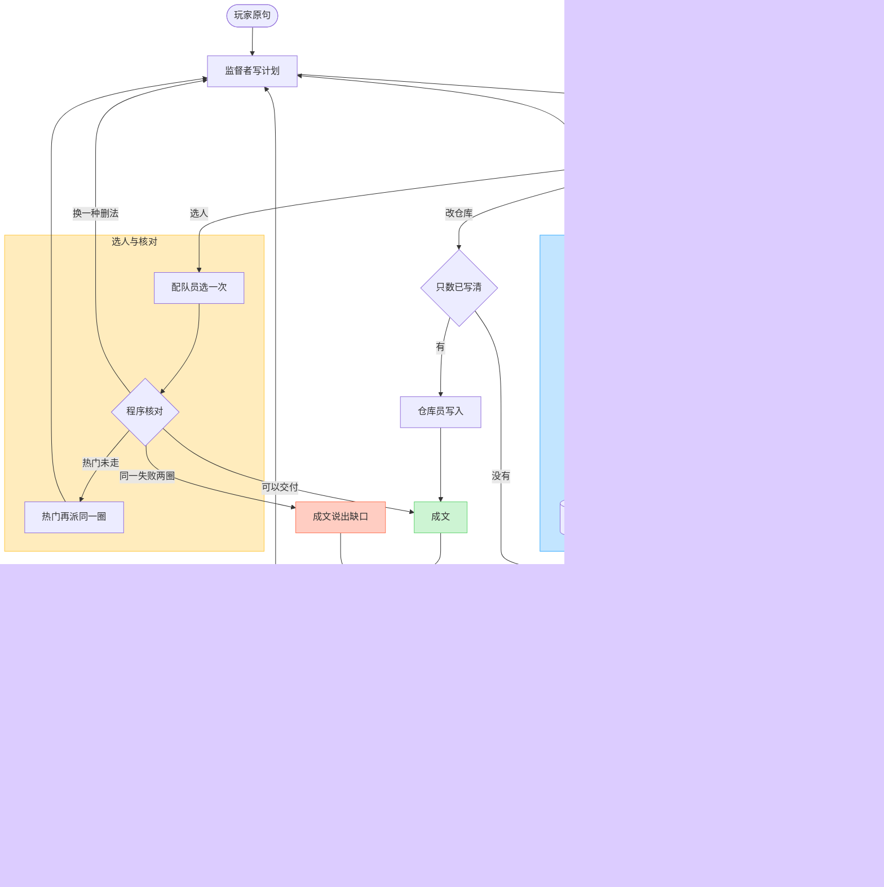

# 灯灯 agent 清单与工作循环

外环是 JoyAgent 的 Plan–Execute：监督者先写计划，工人只填自己的槽。记忆写入用 MemGuard 的准入：对得上当前缺口、具体到能继续做、且不改写名录，才写入这段对话。

玩家看得见的句子仍不出现：文件、表格、接口、字段、提示词、JSON、函数、MCP、API、代码、数据库。

## 清单

| 名称 | 种类 | 读什么 | 写出什么 | 不做 |
| --- | --- | --- | --- | --- |
| 监督者 | Plan–Execute | 玩家原句、工作账本 | 计划版本、下一步调度词 | 不检索，不点名，不写仓库，不对玩家说话 |
| 资料员 | ReAct 工人 | 名录、规则、克制、仓库快照、已准入的对话记忆 | 权威事实，来源标名录或仓库 | 不上网，不写盘，不编名单 |
| 探查员 | ReAct 工人 | 当前缺口对应的公开资料 | 可作废证据，来源标联网 | 不改名录里的种族值、技能、克制，不编名单 |
| 配队员 | 工人 | 账本上的约束和已经确认的事实 | 向账本要缺口；证据够了调用选人程序一次 | 不自己点名，不在资料空着时编组成 |
| 仓库员 | 工人 | 仓库和已保存的出场 | 问清通过后的一次读写；数量来源标仓库 | 只数没写清时不改仓库 |
| 成文 | 工人 | 账本里允许对玩家说的内容 | 一句玩家能看的话 | 不调用工具，不改计划，不改名单 |
| 问清 | 程序门 | 写盘参数、限制对象 | 缺一件就将调度词改为询问 | 一次只问一件，不连问 |
| 记忆准入 | 程序门 | 玩家原话、当前还空着的缺口 | 记或不记；记则写入对话记忆并标成玩家 | 对不上缺口、过于含糊、或改写名录技能特性克制的，不记 |
| 程序核对 | 程序门 | 唯一一份名单 | 倾斜、属性、输出面、蓄力、谁留下、满意或不满意 | 不另写一套六人，不靠模型放行 |

共享的是一份工作账本。权威事实、可作废证据、对话记忆、唯一名单、核对结果都写在账本上。工人之间不聊天。

调度词只留在账本里：`need_local`、`need_web`、`need_both`、`need_write`、`need_ask`、`need_lineup`、`check`、`replan`、`speak`、`stop`。

热门限制不是新专员。监督者把同一圈再派一次：资料员和探查员填热门槽，配队员先清空名单再选一次，程序核对再跑一遍。

## 工作循环

一圈里面的停法：

- 资料空着，或只数、限制对象没写清：成文只问这一件，然后停下。玩家回答先过记忆准入，通过才从断点继续。
- 核对通过且热门那一轮已经走完：成文说出这份名单，结束。
- 同一种核对失败连续两圈：成文说出程序给出的缺口，结束。不满意只换删法，不新开专员。
- 纯写仓库的句子不打开网页槽。只查资料的句子不选人、不保存出场。
