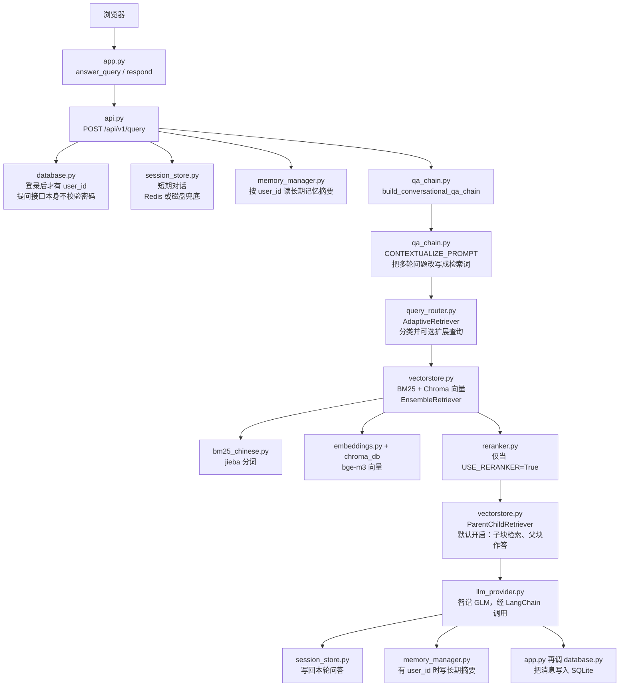

# 政策问答系统项目精读（新手版）

这份精读只根据本仓库源码和仓库内文档写成。读者可以把它当成「第一次打开这个项目时的导游」。

先记住一件事：你在网页里问的问题，不会直接丢给大模型凭空回答。程序会先从政策 PDF 里找出几段原文，再让模型根据这几段来写。这就是后面反复出现的 RAG。

---

## 1. 一分钟看懂它是干什么的

### 解决什么痛点

README 开头写的痛点是：政策文件又多又长，人查起来慢；普通搜索只能对上字面，看不懂「意思相近但用词不同」的问题；如果只问大模型，它可能用过时的记忆编一段听起来像政策的话。

这个仓库要做的事，用一句话说：把本地 PDF 切成小段存起来，提问时先找出相关小段，再让智谱 GLM 根据这些小段作答，并带上来源。

### 用户打开后会看到什么

按本机脚本，有两个入口：

- 网页：`http://127.0.0.1:7862`。`run_web.bat` 和 `app.py` 都写了这个地址。页面是 Gradio，带注册、登录、对话、上传自己的 PDF、看公共文件、强制重建。
- 接口文档：`http://127.0.0.1:8000/docs`。`run_api.bat` 启动 FastAPI。真正干活的问答接口是 `POST /api/v1/query`。

网页自己不检索 PDF。`app.py` 的 `answer_query` 把问题用 HTTP 发给 API，API 算完再把答案和来源画回聊天框。

### 什么是 RAG：为什么不能只用大模型死记政策

**RAG**（Retrieval-Augmented Generation，检索增强生成）可以想成开卷考试：先去书里翻到相关页，再根据那一页写答案，而不是闭卷背诵。

在这个仓库里，「翻书」是混合检索，「写答案」是智谱 GLM。模型仍然会组织语言，但它被要求根据检索到的片段回答。源码里的提示词写了「不要编造未在已知内容中出现的政策信息」。这不能从法律上保证答案正确，只是把模型限制在「看得到的段落」里。

---

## 2. 一张图看懂请求怎么走

下面这张图是 **Gradio 提问** 的默认路径。重排序默认关着，所以图里标成可选。监控脚本不在这条路上，见 6.12。



没有登录也能提问。这时没有 `user_id`，长期记忆不会读也不会写。会话仍然可以由网页先 `POST /api/v1/session` 创建。

---

## 3. 技术栈对照表

| 组件 | 本仓库用什么 | 对应文件 | 新手理解成什么 |
|---|---|---|---|
| LLM | 默认智谱 `glm-4-flash`；可把主模型换成 DeepSeek，另一个当备用 | `llm_provider.py`、`config.py` 的 `OPENAI_MODEL` / `LLM_PROVIDER` | 负责「看完资料后写人话」的大脑 |
| Embedding | `bge-m3`（本地目录 `bge-m3` 优先，否则用远程名 `BAAI/bge-m3`），1024 维、向量做了归一化 | `embeddings.py`、`config.py` | 把一段文字变成一串数字，用来比「意思像不像」 |
| 向量库 | Chroma，目录默认 `chroma_db`，集合名在 `manifest.json` 里切换 | `vectorstore.py` | 按数字相似度找段落的仓库 |
| BM25 | `rank_bm25` 的 BM25Okapi，中文先用 jieba 切开 | `bm25_chinese.py` | 按词对上没有，像查字典，不看「意思像不像」 |
| Rerank | `BAAI/bge-reranker-base`，默认 **关闭** | `reranker.py`，由 `vectorstore.create_hybrid_retriever` 包上去 | 初选之后再精排，只把更贴题的几段留给模型 |
| Web | Gradio 7862 + FastAPI / Uvicorn 8000 | `app.py`、`api.py`、`run_web.bat`、`run_api.bat` | 一个给人点的页面，一个给程序调用的接口 |
| 用户库 | SQLite 文件 `data/policy_qa.db` | `database.py` | 用户名、密码哈希、对话、用户上传记录 |
| 会话 | Redis `redis://localhost:16379/0`；连不上就写 `data/session_store_fallback.json` | `session_store.py`、`scripts/start_redis.bat` | 当前这轮聊天的草稿纸，过期会丢 |
| 长期记忆 | 另一份 SQLite `data/memory.db`，不是用户向量库 | `memory_manager.py` | 把过去问答压成一句摘要存下来 |
| 任务队列 | Redis + RQ，队列名 `policy-qa` | `tasks.py`、`docker-compose.yml` 的 `worker` | 重建索引、处理用户 PDF 时放到后台，避免卡住接口 |
| 评估 | 离线检索指标 + 可选 Ragas | `offline_evaluation.py`、`end_to_end_evaluation.py`、`test_set.json` | 用固定题目给系统打分 |
| 监控 | `monitoring.db`，需单独运行脚本 | `monitoring.py` | 一本查询日志；默认提问路径不会自动写它 |
| Docker | API、Web、Redis、RQ worker 四个服务 | `Dockerfile`、`Dockerfile.web`、`docker-compose.yml` | 把上面这套装进容器一起启动 |
| 日志 | structlog 打成 JSON，请求带 `X-Trace-Id` | `logging_config.py`、`api.py` 的 `request_logging` | 出问题时用来对上「是哪一次请求」 |

---

## 4. 目录地图

每个文件只写两句：它负责什么，新手什么时候会改它。

| 文件 | 一句话职责 | 新手何时会改它 |
|---|---|---|
| `README.md` | 项目介绍和启动说明 | 先读，但和代码冲突时以代码为准，见第 12 节 |
| `EVALUATION_GUIDE.md` | 评估流程说明 | 想跑评测时对照；里面提到的 `run_evaluation.py` 本仓库没有 |
| `requirements.txt` | Python 依赖版本范围 | 缺包、装失败时看这里 |
| `.env.example` | 环境变量模板，没有真实密钥 | 复制成 `.env` 后填 Key |
| `config.py` | 读取 `.env`，给出分块、检索、模型的默认值 | 改权重、开关重排序、换模型名 |
| `api.py` | FastAPI：问答、健康检查、重建、登录、上传 | 改接口字段、返回来源的方式 |
| `app.py` | Gradio 页面，几乎只调用 API | 改网页布局、端口、按钮 |
| `qa_chain.py` | 把检索器、改写提示词、回答提示词装成一条链 | 改「模型该怎么答」 |
| `llm_provider.py` | 智谱 / DeepSeek 的调用和主备切换 | 换供应商、超时、重试 |
| `query_router.py` | 把问题分成精确 / 语义 / 混合 / 多跳，并可选扩展问法 | 改分类规则或各策略的 BM25 / 向量权重 |
| `document_processor.py` | PDF 抽字、OCR、父子块切分 | 改政策怎么被切成小段 |
| `document_processor_mineru.py` | `USE_MINERU=True` 时的另一套抽字和定长切分 | 只有启用 MinerU 才走这里 |
| `vectorstore.py` | Chroma 的建立、加载、双缓冲重建、混合检索 | 改库存哪里、何时整库重做 |
| `embeddings.py` | 创建 bge-m3 嵌入模型 | 换嵌入模型或关闭归一化 |
| `bm25_chinese.py` | jieba 分词后的关键词检索 | 中文对不上面、想改分词时 |
| `reranker.py` | 加载 BGE 重排序模型 | 打开重排序之后，模型下不来时 |
| `database.py` | 用户、对话、消息、用户文档四张表 | 改登录或对话怎么落库 |
| `session_store.py` | 当前会话的短期历史 | 改会话过期时间的存储方式 |
| `user_vectorstore.py` | 每个用户一份 Chroma，路径 `chroma_db/users/user_{id}` | 改个人 PDF 的上限和存放位置 |
| `memory_manager.py` | 长期记忆的摘要写入和读出 | 改「还记得上次问过什么」 |
| `cache_utils.py` | 把切好的文档块 pickle 到磁盘，并用指纹校验 | 重建后 BM25 仍用旧块时来看 |
| `logging_config.py` | JSON 日志和 trace_id | 想改日志格式时 |
| `monitoring.py` | 查询日志库和报表命令 | 想记录线上问答时；默认 API 不会调用它 |
| `tasks.py` | 把重建和用户文档处理丢进 RQ | 改后台任务；本机没 Redis 时这些任务会失败 |
| `offline_evaluation.py` | 只评检索，不算「回答好不好」 | 改 Recall / Precision / MRR 的算法 |
| `end_to_end_evaluation.py` | 评「检索 + 生成」整段回答 | 跑简单打分或 Ragas |
| `test_set_builder.py` | 交互式增删 `test_set.json` | 自己加考题 |
| `test_retrieval_comparison.py` | 对比固定权重检索和自适应检索 | 想看两种检索差异时 |
| `Dockerfile` | API 镜像，暴露 8000 | 改容器里的 Python 依赖 |
| `Dockerfile.web` | Web 镜像，只复制 `app.py`、`config.py`、`database.py` | 改网页容器 |
| `docker-compose.yml` | api、web、redis、worker 一起起 | 用 Docker 而不是 bat 时 |
| `run_api.bat` | 激活 `.venv` 后 `python api.py` | 本机只开接口 |
| `run_web.bat` | 新开窗口跑 API，再跑 `python app.py` | 本机开网页；它会再启动一次 API |
| `start.bat` | 菜单：只 API / 只 Web / 两个都开 | 不知道先点哪个时 |
| `view_report.bat` | 调用 `view_evaluation_report.py` | 仓库里没有这个 py 文件，双击会失败 |
| `test_comparison.bat` | 跑 `test_retrieval_comparison.py` | 对比检索策略 |
| `upload_to_github.bat` | 仓库自带的上传脚本 | 和问答链路无关 |
| `scripts/start_redis.bat` | 尝试启动本机便携版 Redis，默认端口 16379 | 会话想用 Redis，或要重建索引时 |
| `scripts/download_bge_m3.py` | 下载嵌入模型的辅助脚本 | 本机没有 `bge-m3` 目录时 |
| `.github/workflows/ragas-eval.yml` | CI 里跑 Ragas | 本精读不逐行展开 |

---

## 5. 从零启动（按本机脚本写，不要编造命令）

仓库已经克隆的话，从虚拟环境开始。下面的命令来自 `README.md` 和 bat，不另造一套。

1. 进入仓库目录。
2. 创建并激活虚拟环境（README 写的是这一套；`run_web.bat` 也检查 `.venv\Scripts\activate.bat` 在不在）：

```bat
python -m venv .venv
.venv\Scripts\activate
pip install -r requirements.txt
```

3. 复制环境变量模板（README）：

```bat
copy .env.example .env
```

4. 编辑 `.env`，至少填写：

- `ZHIPU_API_KEY`：智谱接口密钥。`config.validate_config` 没有它会直接报错退出。
- `ZHIPU_BASE_URL`：示例是 `https://open.bigmodel.cn`。
- 可选 `DEEPSEEK_API_KEY`：不填则没有备用模型。
- `DATA_DIR` 默认 `data`，`PERSIST_DIRECTORY` 默认 `chroma_db`。

不要把填好的 `.env` 提交到公开仓库。本文不记录任何真实密钥。

5. 先开 API，再开网页。

- 只开接口：双击或运行 `run_api.bat`。它会 `call .venv\Scripts\activate.bat`，然后 `python api.py`。地址是 `http://127.0.0.1:8000`，文档是 `http://127.0.0.1:8000/docs`。
- 开网页：`run_web.bat` 会再开一个窗口执行 `python api.py`，等 5 秒，然后 `python app.py`。网页是 `http://127.0.0.1:7862`。
- `start.bat` 提供 1 / 2 / 3 三个选项，分别对应上面两种和「两个都开」。选 3 时它自己 `start` 了 `run_api.bat`，而 `run_web.bat` 还会再启动一次 API。两个 API 会抢 8000 端口。新手用菜单时选 1 或选 2，不要选 3 再叠加手动开 API。

`api.py` 作为脚本启动时绑定 `127.0.0.1:8000`：

```1078:1088:api.py
if __name__ == "__main__":
    import uvicorn

    validate_config()
    _ensure_directories()
    uvicorn.run(
        "api:app",
        host="127.0.0.1",
        port=8000,
        reload=False,
        log_level="info",
    )
```

网页端口：

```712:716:app.py
    demo.launch(
        share=False,
        server_name=os.getenv("GRADIO_SERVER_NAME", "127.0.0.1"),
        server_port=int(os.getenv("GRADIO_SERVER_PORT", "7862")),
        favicon_path=None,
    )
```

### PDF 放哪、索引何时建立

代码在 `DATA_DIR`（默认就是项目下的 `data/`）里找 `*.pdf`，不是 README 写的 `data/policy_pdfs/`。

```522:536:document_processor.py
    data_path = Path(data_dir)
    if not data_path.exists():
        print(f"警告：数据目录不存在，正在创建：{data_dir}")
        data_path.mkdir(parents=True, exist_ok=True)
        return []

    pdf_files = sorted(data_path.glob("*.pdf"))
    if not pdf_files:
        print(f"提示：在目录 {data_dir} 中未找到 PDF 文件，请将 PDF 文件放入该目录")
        return []
```

API 启动时 `lifespan` 会调用 `_ensure_chain`。`chroma_db` 里已经有文件，就直接加载，不会因为你新放了一个 PDF 就自动重建。没有向量库时，才会调用 `load_and_split_pdfs` 再 `build_or_load_vectorstore`。

已经有库、只是换了 PDF：调用 `POST /api/v1/rebuild`。这个接口把任务放进 Redis 队列，本机还要有 RQ worker。Redis 或 worker 没起来时，接口返回 503，详情是「任务队列不可用，请确认 Redis 与 worker 已启动」。Docker 里这个 worker 就是 `docker-compose.yml` 的 `worker` 服务，命令是 `rq worker policy-qa`。

源码里没有名为 `build_vectorstore` 的函数。重建入口是 `vectorstore.build_or_load_vectorstore` 和 `tasks.run_rebuild`。

### 常见失败

| 现象 | 源码里的原因 |
|---|---|
| 一启动就退出，提示缺少 `ZHIPU_API_KEY` | `config.validate_config`。`api.py` 和 `app.py` 的 `__main__` 都会调用它。网页进程即使只转发请求，没 Key 也起不来 |
| 提示将使用远程 `BAAI/bge-m3`，或卡在下载 | 项目根目录没有 `bge-m3` 文件夹。`config.py` 只认这个目录名 |
| 问答说没有可用政策文档 | `data/` 下没有 PDF，或向量库是空的 |
| 8000 或 7862 被占用 | `start.bat` 选项 3 会和 `run_web.bat` 各起一次 API；或上次窗口没关 |
| 重建或上传个人 PDF 失败 | `enqueue_rebuild` / `enqueue_process_user_document` 需要 Redis。默认提问不依赖这次入队 |
| 重排序打不开 | `reranker.py` 先找本机 HuggingFace 缓存，没有再尝试镜像。`USE_RERANKER` 默认是 False，不开启就不会走这里 |
| `view_report.bat` 报找不到脚本 | 它执行 `python view_evaluation_report.py`，仓库中没有这个文件 |

Redis 便携版脚本写明：可执行文件要放在 `%USERPROFILE%\tools\redis8\Redis-8.10.0-Windows-x64-msys2\redis-server.exe`，默认端口 **16379**，和 `config.py` 里的 `REDIS_URL` 默认值一致。脚本注释说 6379 落在这台机器的 Hyper-V 保留端口段里，所以不用 6379。

---

## 6. 核心链路精读

### 6.1 政策 PDF 怎么变成可以检索的小段

**Chunk**（块）就是切出来的一小段文字。政策全文太长，塞不进一次检索，也不适合整本拿去比相似度，所以要切开。相邻块留一点重复，叫重叠（overlap），避免一句话正好被切在边界上、两边都看不懂。

默认 `USE_PARENT_CHILD=True`。这时不是只切一种块，而是两种：

- **父块**：尽量按「第 X 条」这类标题切开，最长大约 `PARENT_CHUNK_SIZE`（默认 2000 字）。回答时希望模型看到较完整的一条。
- **子块**：在父块里面再切，长度 `CHILD_CHUNK_SIZE`（默认 500），重叠 `CHILD_CHUNK_OVERLAP`（默认 50）。检索时用短块，比较容易命中那一句。

输入是 `data/*.pdf`。`load_and_split_pdfs` 用 PyMuPDF 抽文字；整份抽出来是空的，才调用 `_ocr_pdf`（EasyOCR）。然后 `split_parent_child` 返回父块和子块。子块拿去入库，父块用 pickle 存到 `data/_parent_documents_cache.pkl`。

按章节切分是另一条路：只有 `USE_PARENT_CHILD` 为假且 `CHUNK_BY_SECTION=True` 时，才走 `split_by_section`。两个都是假，才用固定长度 `RecursiveCharacterTextSplitter`，块大小是 `config.CHUNK_SIZE`（写死 500）。

子块长这样（字段以代码为准）：

```432:440:document_processor.py
            child_docs.append(Document(
                page_content=sub_text,
                metadata={
                    "source": source_name,
                    "page": parent_page,
                    "parent_id": parent_id,
                    "section_title": parent_doc.metadata.get("section_title", ""),
                    "chunk_type": "child",
                }
            ))
```

`USE_METADATA_AUGMENT` 默认真。`augment_metadata` 会补 `section_title`。`USE_KEYWORD_EXTRACT` 默认也真，但 `load_and_split_pdfs` 的 `llm` 参数默认是 `None`，API 启动时没有把模型传进去，所以关键词走 `_extract_keywords_by_rules`，不会为了每个块再请求一次智谱。

失败时：某个 PDF 抛错会被 `except` 吃掉并打印「已跳过」。目录里没有任何有效块，函数返回空列表，API 日志是「没有找到可用文档」。

### 6.2 向量化与 Chroma 存哪里、何时重建

**Embedding**（嵌入）是把一段文字变成一串数字。意思接近的两段，数字也接近。**向量库**就是专门按这串数字查找的数据库。这里用 Chroma，目录是 `PERSIST_DIRECTORY`，默认 `chroma_db`。

`embeddings.create_embeddings` 使用 HuggingFace 的 bge-m3，并打开归一化，方便用余弦相似度比较。

```9:16:embeddings.py
def create_embeddings():
    from langchain_community.embeddings import HuggingFaceEmbeddings

    return HuggingFaceEmbeddings(
        model_name=EMBEDDING_MODEL,
        model_kwargs={"trust_remote_code": True},
        encode_kwargs={"normalize_embeddings": True},
    )
```

`EMBEDDING_MODEL` 不是 `.env` 里的一个变量。`config.py` 看项目根下有没有文件夹 `bge-m3`：有就用本地路径，没有就用字符串 `BAAI/bge-m3`。

写入时走双缓冲：集合名在 `langchain_a` 和 `langchain_b` 之间切换。新集合写完、条数对得上、还能做一次搜索，才改 `chroma_db/manifest.json` 的 `active_collection`，然后删旧集合。这样重建失败时，旧库还在。

```304:311:vectorstore.py
def _rebuild_double_buffer(client, embeddings, documents: List[Document], persist_directory: str) -> Chroma:
    """双缓冲区重建：写入非 active 集合 -> 验证 -> 原子切换 -> 删除旧集合

    任一步失败都不会破坏当前 active 集合，替代原来 shutil.rmtree 删库的重建方式。
    """
```

什么时候会重建：

- 启动时 `chroma_db` 是空的：进程内直接构建。
- `POST /api/v1/rebuild`：交给 `tasks.run_rebuild`。`force=true`，或指纹和当前配置不一致，就全量重建；否则按 PDF 文件名做增量（新增入库、删除的文件按 `source` 删向量）。
- 构建指纹 `compute_build_fingerprint` 覆盖嵌入模型、是否 MinerU、分块大小、是否父子块、是否做元数据增强。这些变了，旧缓存会被 `cache_utils` 拒绝加载，并提示建议重建。

`config.py` 里的 `CHUNK_SIZE` / `CHUNK_OVERLAP` **没有** `os.getenv`。`.env` 里改这两个名字，不会改变 `config.py` 里的 500 和 50。父子块大小 `PARENT_CHUNK_SIZE` 等是读环境变量的。

### 6.3 混合检索：BM25 权重 + 向量权重如何融合

**BM25** 是一种「词出现得巧不巧」的打分。政策里的专有名词、条款编号，字面一致时它很有用。向量检索则是「意思像不像」。两边各找一批候选，再合成一份名单。

权重来自 `config.py`：

```53:54:config.py
BM25_WEIGHT = float(os.getenv("BM25_WEIGHT", "0.5"))
VECTOR_WEIGHT = float(os.getenv("VECTOR_WEIGHT", "0.5"))
```

真正交给融合器的是这两行。本仓库没有自己写加权公式，而是把权重传给 LangChain 的 `EnsembleRetriever`：

```475:479:vectorstore.py
        ensemble_retriever = EnsembleRetriever(
            retrievers=[bm25_retriever, vector_retriever],
            weights=[bm25_weight, vector_weight]
        )
```

默认各 0.5。`validate_config` 只在两者相加不是 1.0 时打印警告，不会阻止启动。

自适应检索打开时（默认打开），固定的 `BM25_WEIGHT` **不会**用在主链上。`qa_chain.build_retriever` 按问题类型使用 `STRATEGY_CONFIG` 里的另一套权重，例如「精确」是 BM25 0.8、向量 0.2。每种策略里还有一个 `retrieval_k`（10 到 20），但 `build_retriever` 创建检索器时传入的是 `k=RETRIEVAL_K`（默认 3），没有读取 `cfg["retrieval_k"]`。所以分类会改权重，不会改成策略表里写的那档条数。

每个子检索器取多少条：`create_hybrid_retriever` 里，不开重排序时 `retrieval_k = k`；开了则先取 `k * 2`，留给重排序筛选。

没有原始文档列表时（缓存指纹对不上就会这样），函数打印警告，只做向量检索，BM25 不参加。

用户个人库和公共库合并时，`CombinedRetriever` 的 `public_weight` / `user_weight` 被传进去了，但排序代码是「公共片段在前，用户独有片段在后」，没有用这两个数字做加权：

```141:142:vectorstore.py
        # 公用文档优先，用户独有文档在后
        unique_docs = public_docs + user_docs
```

另外，`qa_chain.py` 调用了 `database.get_user_uploads`。`database.py` 里没有这个函数，只有 `get_user_documents`。这段在 `except` 里把「有没有上传」当成假，于是个人库检索会被跳过。源码看起来是写了联合检索，默认提问路径走不进去。

### 6.4 中文分词（jieba）为什么需要

BM25 的计分单位是词，不是整句。英文可以用空格切开。「增值税小规模纳税人」如果按字切，会变成一堆单字，和问句对不上；按词切，才知道这是一个政策术语。

```21:27:bm25_chinese.py
def chinese_tokenizer(text: str) -> List[str]:
    """中文分词器"""
    if JIEBA_AVAILABLE:
        return list(jieba.cut(text))
    else:
        # 简单分词：按字符分割
        return [char for char in text if char.strip()]
```

jieba 没装时退回按字切，并打印警告。`ChineseBM25Retriever` 在初始化时给每一块分词，建成 `BM25Okapi` 索引；查询时对问题同样分词，取得分最高的 `k` 块。

向量检索不用 jieba。分词只服务 BM25。

### 6.5 重排序 BGE-reranker 插在哪一步、进 LLM 的是 Top 几段

**Rerank**（重排序）像海选之后的复试。BM25 和向量先各交上一批「可能相关」的段落，重排序模型再把「问题和这一段放在一起看」打一个更细的分，丢掉不太像的。

它插在混合检索之后、交给问答链之前。`USE_RERANKER` 为真时，`create_hybrid_retriever` 用 `CrossEncoderReranker` 包住基础检索器；包装失败则用 `ManualRerankerRetriever`。阈值 `RERANKER_THRESHOLD` 只在手动那条路径里用来丢弃低分；LangChain 那个压缩器的构造参数里只看到 `top_n=top_k`。

默认 `USE_RERANKER=False`，这段不会执行。

进模型的段数：

- 默认：`RETRIEVAL_K=3`，重排序关闭，每个子检索器返回 3 条，融合后的列表交给模型。父子块开启时，多个子块可能映射成同一个父块，模型看到的是去重后的父块，条数可能更少。
- 打开重排序：候选先变成 `RETRIEVAL_K * 2`，再留下 `RERANKER_TOP_K`（默认 5）条。

`QueryRequest.top_k` 默认 5，但 `query()` 没有把它传给检索器。它不影响主问答。`GET /api/v1/search` 的 `top_k` 才会作为向量检索的 `k`。

API 返回给前端的 `sources`，不是模型写在答案里的引用，而是检索结果的前 3 条：

```538:540:api.py
        # 直接返回检索结果中最相关的文档（前3个）
        # 不再尝试从LLM回答中提取引用，因为LLM的引用格式不可控
        sources = extract_sources(source_documents[:3]) if source_documents else []
```

`extract_cited_sources` 被 import 了，函数体内没有调用。

### 6.6 qa_chain 如何把「检索到的段落 + 用户问题 + 记忆」拼成提示词

输入是字典：`input`（问题）、`chat_history`（短期对话）、`memory_context`（长期记忆拼好的字符串）。

`build_conversational_qa_chain` 做三件事：

1. `create_history_aware_retriever`：用 `CONTEXTUALIZE_PROMPT` 把「历史 + 当前问题」收成一句检索词。提示词要求只输出不超过 30 字的查询，不要直接回答。
2. 用这句检索词跑第 6.3 节的检索器。
3. `create_stuff_documents_chain`：把检索到的段落填进 `QA_PROMPT` 的 `{context}`，把记忆填进 `{memory_context}`，当前问题填进 `{input}`。

```247:255:qa_chain.py
    history_aware_retriever = create_history_aware_retriever(
        llm, retriever, CONTEXTUALIZE_PROMPT
    )
    
    question_answer_chain = create_stuff_documents_chain(llm, QA_PROMPT)
    
    conversational_chain = create_retrieval_chain(
        history_aware_retriever, question_answer_chain
    )
```

`format_docs_with_citations` 能给每段加上 `[citation:N]`，但全仓库只有定义、没有调用。因此提示词虽然要求模型使用 `[citation:X]`，检索段落并不是由这个函数贴上标签的。段落怎么拼进 `{context}`，由 LangChain 的 stuff 链默认格式决定。

`QA_PROMPT` 里有两条都编号为 2 的要求：一条是关键词没出现就必须回答「未检索到」；紧接着另一条又说内容不完整也要尽量回答。模型会同时看到这两句。

`invoke_chain_with_memory` 能代为调用链，但 `api.py` 只 import 了它，`query()` 是直接 `current_chain.invoke(...)`。记忆字符串是在 `api.py` 里先算好，放进 `memory_context` 字段的。

失败时：链抛异常，`query()` 记日志并返回 HTTP 500，`detail` 里带异常文字。知识库还在建，则返回 `status=loading` 的说明，而不是 500。

### 6.7 智谱 GLM 在 llm_provider.py 里怎么调用，和 LangChain 的关系

LangChain 是一套把「提示词、检索器、模型」粘在一起的库。本仓库不直接手写 HTTP 解析智谱响应，而是用 `langchain_zhipu.ChatZhipuAI` 这个现成聊天模型。问答链要的是一个带 `.invoke` 的对象，所以 `ZhipuProvider.llm` 把这个对象交出去。

```97:127:llm_provider.py
class ZhipuProvider(BaseLLMProvider):
    """智谱 GLM-4-flash（主供应商）"""

    name = "zhipu"
    ...
    def _invoke_once(self, prompt: Union[str, List[Any]], **kwargs) -> Any:
        return self._chat.invoke(prompt, **kwargs)
```

默认模型名是 `config.OPENAI_MODEL`，缺省 `glm-4-flash`。变量名叫 OPENAI，是历史命名；默认供应商仍是智谱。`ZHIPU_BASE_URL` 如果写成了带 `/api/paas/v4` 的旧地址，`_normalize_zhipu_base_url` 会把这段后缀去掉，因为所用的 langchain_zhipu 会自己再拼路径。

`get_llm_provider` 做成主备：`LLM_PROVIDER=zhipu` 时主是智谱、备是 DeepSeek（没 Key 就没有备）。`FallbackLLMProvider.invoke` 在主供应商重试失败后改调备用。重试只针对 `TimeoutError`、`ConnectionError`、`OSError`，次数默认 3，等待从 1 秒指数增加到最多 10 秒。

问答链用的是 `provider.llm`，也就是主模型那个 LangChain 对象，不经过 `FallbackLLMProvider.invoke`。所以主链上的生成失败，不会自动切到 DeepSeek。会走 `provider.invoke` 的是长期记忆摘要那一次调用。

评测用的智谱模型子类 `ZhipuJudgeChatZhipuAI` 把 temperature 四舍五入到两位小数，注释写明是为了躲开智谱接口对小数位数的限制。

### 6.8 查询路由 query_router.py：什么问题走检索、什么可能不走

这里的「路由」不是「有的问题不检索」。四种类型都会检索。它只决定用哪一套 BM25 / 向量权重，以及要不要把一个问题改写成多条问法再各搜一次。

| 类型 | 源码里的权重 | 扩展查询 |
|---|---|---|
| 精确 | BM25 0.8 / 向量 0.2 | 跳过 |
| 语义 | BM25 0.1 / 向量 0.9 | 跳过 |
| 混合 | 0.5 / 0.5 | 默认会扩展 |
| 多跳 | 0.5 / 0.5 | 默认会扩展 |

规则预过滤几乎只拦截多跳：问题里出现「同时」「还能」「叠加」「是否可」「又」「以及」「可否」就直接标成多跳，不再问模型。其余情况 `_classify_by_rules` 返回 `None`，再调用 LLM 做分类。常量 `PRECISE_KEYWORDS_PATTERNS` 定义了，分类函数没有使用它。

扩展由另一次 LLM 调用完成，要求输出 2 个不同角度的问法。然后和原问题一起，用线程池并行检索，按「来源 + 正文前 80 字」去重。

`USE_ADAPTIVE_RETRIEVAL=False` 时不建 `AdaptiveRetriever`，改用 `config` 里的固定权重，也不做分类和扩展。离线评测可以传 `adaptive=False`，避免评检索时还去调用模型。

源码里没有「闲聊就跳过检索」的分支。政策无关的问题仍会检索，再由 `QA_PROMPT` 第 5 条允许模型说明「这和已上传政策无关」。

### 6.9 用户注册登录、密码哈希、会话

**Session**（会话）是「这一次连续聊天」的编号。同一个 session 里的上一问下一问可以接上。它和「数据库里的用户账号」不是同一件事。

注册登录在 `database.py`：

- 库文件：`data/policy_qa.db`。
- `hash_password` 是 `hashlib.sha256` 的十六进制字符串。源码里没有盐，也没有 bcrypt。
- `create_user` 要求走 API 模型：用户名 3～50 字，密码 6～100 字。用户名重复会失败（表上有 `UNIQUE`）。
- `login_user` 用同样的哈希比对，成功就更新 `last_login`。

API 没有在 `/api/v1/query` 上检查密码或令牌。网页登录成功后，把 `user_id` 放进后续 JSON。知道或猜到一个整数 id，就可以带上它调用接口。这是本地演示级做法，不是企业登录。

短期会话不在这张用户表里。`POST /api/v1/session` 调用 `session_store.create()`，得到一个 uuid。历史消息以 JSON 存在 Redis 键 `session:{id}`，TTL 默认 3600 秒，读一次就顺延。Redis 连不上时，写到 `data/session_store_fallback.json`，每 30 秒再试一次 Redis，连上后把兜底会话迁过去。

Gradio 在已登录且选中了对话时，还会用 `database.save_message` 把用户句和助手句写入 SQLite。这是「可在下次登录看到的历史」，和 session 里的短期上下文是两份存储。

### 6.10 记忆分层：短期（当前对话）和长期（摘要进用户向量库）何时读写

README 写长期记忆在「向量数据库」。**代码不是这样。** 长期记忆在 SQLite `data/memory.db` 的表 `long_term_memory`。`embedding` 列在建表语句里有，`save_long_term_memory` 的 INSERT 没有写这一列。检索也不是向量搜索，而是按 `importance_score` 和创建时间排序，取重要性不低于 0.3 的若干条。`current_question` 参数没有出现在 SQL 里，所以它并不按「这句问话像不像某条记忆」来挑。

用户个人向量库 `user_vectorstore.py` 存的是用户上传的 PDF 切块，不是对话摘要。

读写时机（都要求请求里带了 `user_id`，且 `memory_manager` 导入成功）：

- **读**：`query()` 在调用链之前执行 `build_memory_context`。长期部分是摘要列表；短期部分是 session 历史的最后 4 条，每条内容截到 100 字，拼进 `memory_context`。另外，链内部的 `chat_history` 还会整段传给改写提示词和回答提示词。所以短期历史进模型两次：一次是完整消息列表，一次是记忆字符串里的截断版。
- **写**：回答成功后 `save_long_term_memory`。它先让模型把这一问一答收成 JSON（摘要、实体、重要性、类型），再插入 SQLite。`conversation_id` 参数实际上传入的是 `session_id` 字符串。表定义里这个外键指向 `conversations.id`（整数）。源码没有在这里做类型转换。

`cleanup_old_memories` 可以删掉 30 天前且重要性低于 0.3 的行。全仓库没有看到别的文件调用它，所以它不会自动跑。

### 6.11 缓存 cache_utils / Redis 在不在默认路径上

两套「缓存」，不要混：

1. **文档块缓存**（`cache_utils.py`）在默认路径上。API 构建或加载知识库时，会读 `data/_documents_cache.pkl` 和父块缓存。边车文件是同名加 `.meta.json`，里面有构建指纹。指纹和 `manifest.json` 不一致就返回 `None`，BM25 退化为纯向量检索。这不是 Redis。
2. **Redis** 不在「能回答问题」的必经之路上。`session_store` 会尝试连接，失败就用磁盘。`tasks.py` 的重建和用户 PDF 处理才硬性需要 Redis 和 worker。本机只跑 `run_api.bat`、不跑 `scripts/start_redis.bat` 时，提问仍然可以工作（只要 Key、嵌入模型和向量库就绪）。重建和上传个人文档会 503。

Docker Compose 把 Redis 放进同一组服务，API 的 `REDIS_URL` 默认改成 `redis://redis:6379/0`，并 `depends_on` worker 所依赖的 Redis。那是容器路径，和本机 bat 不是同一条启动方式。

### 6.12 监控 monitoring.py 记录了什么

`monitoring.py` 自己建 `monitoring.db`（在项目根，不在 `data/`）。两张表：

- `query_logs`：问题、回答、来源 JSON、耗时、`user_id`、`session_id`、用户反馈、分类、创建时间。
- `retrieval_logs`：某次查询命中的文件名、名次、分数、片段文本。

`log_query` 负责插入。在 `api.py` 里没有调用它。因此默认问答不会留下监控记录。要有数据，需要别的代码调用 `log_query`，或你自己在脚本里调用。仓库内能看到的入口是命令行：`python monitoring.py --report --days 7` 以及 `--export`。`EVALUATION_GUIDE.md` 里的示例输出（150 次查询、满意度 80%）是文档里的示例，不是本精读从运行结果里抄来的。

---

## 7. 数据长什么样

下面是形状示例，不是某份真实政策 PDF 的原文。

### 一个 chunk

父块、子块都是 LangChain 的 `Document`：`page_content` 是文本，`metadata` 是字典。子块在元数据增强之后，大致是：

```json
{
  "page_content": "（这里是不超过子块长度的政策原文片段）",
  "metadata": {
    "source": "某政策.pdf",
    "page": 3,
    "parent_id": "parent_1a2b3c4d_0",
    "section_title": "第一条",
    "chunk_type": "child",
    "keywords": "从规则里抽出的词，可能是空字符串"
  }
}
```

`parent_id` 用文件名的 md5 前 8 位加序号，避免不同 PDF 都从 0 编号时互相覆盖。页码是用片段在全文中的位置回推的，抽不出来时是 0。重排序若走手动路径，还会多一个 `relevance_score`。

### 一次问答 API

请求模型：

```281:287:api.py
class QueryRequest(BaseModel):
    question: str = Field(..., min_length=1, max_length=2000, description="用户问题")
    top_k: int = Field(default=5, ge=1, le=20, description="检索返回文档数量")
    session_id: Optional[str] = Field(default=None, description="会话ID（用于多轮对话）")
    include_history: bool = Field(default=False, description="是否包含对话历史")
    user_id: Optional[int] = Field(default=None, description="用户ID（用于长期记忆）")
```

示例请求：

```json
{
  "question": "小微企业有哪些税收优惠？",
  "top_k": 5,
  "session_id": "上一步 /session 返回的 id",
  "include_history": true,
  "user_id": 1
}
```

`include_history` 为假时，即使有 `session_id`，也不会把旧消息送进链。回答成功后仍会 `extend` 写回。Gradio 固定传 `include_history: true`。

响应模型是 `answer`、`sources`、`status`。`sources` 每一项是 `extract_sources` 拼的字符串：文件名、页码、以及最多 300 字的原文摘录，不是一个嵌套对象。

```json
{
  "answer": "根据检索到的段落写成的回答",
  "sources": [
    "某政策.pdf (第3页)\n> 原文摘录..."
  ],
  "status": "success"
}
```

知识库还在初始化时，`status` 可以是 `loading`，`answer` 是一句请稍后重试的说明。

### SQLite 有哪些表、一行对话怎么存

`data/policy_qa.db`：

| 表 | 主要列 |
|---|---|
| `users` | `id`，`username`，`password_hash`，`created_at`，`last_login` |
| `conversations` | `id`，`user_id`，`session_id`，`title`，`created_at`，`updated_at` |
| `messages` | `id`，`conversation_id`，`role`，`content`，`sources`，`created_at` |
| `user_documents` | `id`，`user_id`，`filename`，`original_filename`，`file_path`，`file_size`，`upload_time`，`status`，`error_message` |

一行助手消息由 `save_message` 写入。`sources` 是 JSON 字符串，不是单独的表。`role` 在网页侧是 `"user"` 或 `"assistant"`。

```214:226:database.py
def save_message(conversation_id: int, role: str, content: str, sources: List[str] = None) -> int:
    """保存消息"""
    conn = get_connection()
    cursor = conn.cursor()
    
    try:
        created_at = time.time()
        sources_json = json.dumps(sources) if sources else None
        
        cursor.execute(
            "INSERT INTO messages (conversation_id, role, content, sources, created_at) VALUES (?, ?, ?, ?, ?)",
            (conversation_id, role, content, sources_json, created_at)
        )
```

`data/memory.db` 另有表 `long_term_memory`：用户、对话 id、类型、原文 JSON、摘要、实体 JSON、重要性、访问次数。它和 `messages` 不是同一行。

测试题 `test_set.json` 的一条，字段由 `test_set_builder.add_test_case` 决定：`id`、`question`、`expected_answer_keywords`、`expected_sources`、`difficulty`、`category`、`ground_truth`、`created_at`。`expected_sources` 存的是文件名，不是段落编号。

---

## 8. 配置项手册

「默认值」指 `config.py` 在环境变量缺失时的行为。`.env.example` 里有、但 `config.py` 不读的，单独注明。

| 变量名 | 默认值 | 改它会影响哪一步 | 新手建议 |
|---|---|---|---|
| `ZHIPU_API_KEY` | 空；启动时 `validate_config` 失败 | 所有智谱调用 | 必填。没有它 API 和网页都起不来 |
| `ZHIPU_BASE_URL` | `https://open.bigmodel.cn` | 智谱请求地址 | 保持示例值，除非你有网关 |
| `LLM_PROVIDER` | `zhipu` | 谁当主模型 | 先不要改。改成 `deepseek` 则主备对调 |
| `OPENAI_MODEL` | `glm-4-flash` | 智谱模型名 | 想换 GLM 型号再改 |
| `DEEPSEEK_API_KEY` | 空 | 备用供应商能否建成 | 可留空。留空则没有备用 |
| `DEEPSEEK_BASE_URL` | `https://api.deepseek.com` | 备用模型地址 | 用备用时再填 |
| `DEEPSEEK_MODEL` | `deepseek-chat` | 备用模型名 | 同上 |
| `LLM_TIMEOUT` | 60 | DeepSeek 客户端超时秒数 | 智谱那个 `ChatZhipuAI` 构造时源码没把 timeout 传进去 |
| `LLM_MAX_RETRIES` | 3 | `llm_provider.invoke` 的重试次数 | 网络不稳可以加大；主问答链不走这个 invoke |
| `DATA_DIR` | `data`（相对路径会变成项目内绝对路径） | PDF 从哪读、缓存写哪 | 把 PDF 放进这个目录 |
| `PERSIST_DIRECTORY` | `chroma_db` | 向量库存哪 | 换目录等于换一座新库，需要重建 |
| `REDIS_URL` | `redis://localhost:16379/0` | 会话和 RQ | 和 `scripts/start_redis.bat` 的端口保持一致 |
| `SESSION_TTL` | 3600 | 会话多少秒过期 | 演示可以加长 |
| `USE_MINERU` | False | 为真且导入成功时，改用 `document_processor_mineru.load_and_split_pdfs` | 默认用 `document_processor.py`。MinerU 那条路径只做定长切分，没有父子块 |
| `CHUNK_SIZE` / `CHUNK_OVERLAP` | **代码写死 500 / 50**，不读 `.env` | 非父子块时的切分；用户文档任务也用这个常量 | 改 `.env` 无效。要改请改 `config.py` 里的赋值，并重建索引 |
| `CHUNK_BY_SECTION` | False | 仅当父子块关闭时，改为按章节标题切 | 默认走不到。父子块优先 |
| `USE_RERANKER` | False | 混合检索后是否精排 | 先跑通再开。需要本机有 reranker 模型 |
| `RERANKER_MODEL` | `BAAI/bge-reranker-base` | 精排模型名或本地路径 | 下载失败时按 `reranker.py` 末尾的提示改成本地目录 |
| `RERANKER_TOP_K` | 5 | 精排后留下几段 | 只在重排序开启时有用 |
| `RERANKER_THRESHOLD` | 0.0 | 手动重排序路径的最低分 | 0 表示不按分数丢弃 |
| `BM25_WEIGHT` / `VECTOR_WEIGHT` | 0.5 / 0.5 | **仅**自适应检索关闭时的固定混合 | 默认主链用的是 `query_router.STRATEGY_CONFIG` |
| `USE_PARENT_CHILD` | True | 子块检索、父块送进模型 | 这是默认切分方式。关掉才会退回按章节或定长 |
| `PARENT_CHUNK_SIZE` | 2000 | 父块最长大约多少字 | 太大则进模型的上下文变长 |
| `CHILD_CHUNK_SIZE` | 500 | 用来检索的子块长度 | 和重叠一起改完要重建 |
| `CHILD_CHUNK_OVERLAP` | 50 | 子块之间重复多少字 | 同上 |
| `USE_METADATA_AUGMENT` | True | 是否写章节标题等元数据 | 参与构建指纹 |
| `USE_KEYWORD_EXTRACT` | True | 是否用规则写 `keywords` | 默认不会因此调用大模型 |
| `USE_ADAPTIVE_RETRIEVAL` | True | 是否先分类再选权重 | 想少调用几次模型可以设为 False |
| `USE_QUERY_EXPANSION` | True | 混合 / 多跳是否再生成问法 | 每多一次扩展就多一次模型调用和几路检索 |
| `RETRIEVAL_K` | 3 | 每个子检索器返回条数 | 想多看几段就加大。策略表里的 `retrieval_k` 目前不会覆盖它 |
| `MAX_USER_DOCUMENTS` | 10 | 每人最多几个 PDF | 在 `user_vectorstore.py` 读取，不在 `config.py` |
| `MAX_USER_FILE_SIZE` | 10485760（10MB） | 单个用户 PDF 上限 | 同上 |
| `API_BASE_URL` | `http://127.0.0.1:8000/api/v1` | 只影响 Gradio 访问哪台 API | Docker 里 compose 把它改成 `http://api:8000/api/v1` |
| `GRADIO_SERVER_NAME` / `GRADIO_SERVER_PORT` | `127.0.0.1` / `7862` | 网页监听地址 | 端口冲突时改端口 |

`.env.example` 没有列出 `USE_PARENT_CHILD`、`RETRIEVAL_K`、`USE_ADAPTIVE_RETRIEVAL` 等，但代码有默认值，不写进 `.env` 也会生效。

Docker Compose 里有的默认值和本机 `config.py` 不同，例如 compose 把 `USE_RERANKER` 默认成 True、`CHUNK_BY_SECTION` 默认成 True、`RETRIEVAL_K` 默认成 10。用 bat 启动时以 `config.py` 为准；用 compose 时，这些环境变量会传进容器，其中 **被 `os.getenv` 读到的** 才会改变行为。`CHUNK_SIZE` 即使 compose 传了，`config.py` 仍使用写死的 500。

---

## 9. 评估体系

仓库用固定题目 `test_set.json` 给系统打分。题目可以手写，也可以 `python test_set_builder.py` 进菜单。`generate_test_cases_from_documents` 能从已切块里抽句子造题，那种题是程序生成的，不是人工逐条核对过的法律答案。

### 离线：只看检索，不看回答写得好不好

脚本：

```bat
python offline_evaluation.py
python offline_evaluation.py --retriever-only
```

`--retriever-only` 不建问答链，适合还没配好模型、只想看检索的时候。报告写到项目根的 `offline_evaluation_report.json`。

三个指标都是拿「检索到的文件名」和题目里的 `expected_sources` 比。比的是文件名是否互相包含，不是某一段原文在不在。

- **Recall@K**（召回率）：该找的文件里，前 K 个结果覆盖了多少比例。生活类比：老师指定了 2 本参考书，你交上来的前 K 份笔记里出现了几本。全出现了就是 1。
- **Precision@K**（精确率）：前 K 个结果里，有多少比例是那本该找的书。你交了 5 份，只有 1 份来自指定书，精确率就低。同一文件的重复块，代码在分子里去重，分母仍用 K，所以重复命中同一 PDF 会把精确率拉低。
- **MRR**（Mean Reciprocal Rank，平均倒数排名）：第一次命中指定文件出现在第几名。第 1 名就是 1，第 2 名就是 1/2。越靠前越好。

因为标准答案只标了文件名，文件找对了、段落找错了，Recall 仍然可以是 1。读报告时要记住这一点。

### 端到端：检索加生成

脚本：

```bat
python end_to_end_evaluation.py
python end_to_end_evaluation.py --ragas
python end_to_end_evaluation.py --ragas --limit 5
python end_to_end_evaluation.py --ragas --ci
```

默认简单模式不看语义，只算：

- 关键词覆盖：`ground` 侧的 `expected_answer_keywords` 有多少出现在回答字符串里。
- 来源准确率：检索到的文件名里，有多少对上 `expected_sources`。
- 回答长度的平均值。

报告文件是 `e2e_evaluation_report.json`。

`--ragas` 使用 Ragas，指标名在参数说明里写的是：faithfulness（回答是否忠于检索内容）、answer_relevancy（回答是否贴题）、context_precision、context_recall、answer_correctness。这会再调用模型当裁判，所以更慢，也要 Key。`--ci` 时低于 `CI_THRESHOLDS` 就以非 0 退出。默认门槛是 faithfulness 0.80、answer_relevancy 0.70、context_precision 0.60、context_recall 0.70、answer_correctness 0.60。

`EVALUATION_GUIDE.md` 里的 `python run_evaluation.py` 和 `run_evaluation.bat` 在当前仓库文件列表中不存在。能跑的是上面两个 py。

---

## 10. 给新手的阅读顺序

按「先跑起来 → 跟一次提问 → 再看检索 → 再看记忆和登录」。

1. `README.md` 和 `.env.example`：知道要填哪个变量。读完对照第 12 节，避免照着过时命令做。
2. `run_api.bat`、`api.py` 末尾的 `uvicorn.run`、`lifespan`：服务怎么起来，启动时会初始化数据库和知识库。
3. `app.py` 的 `answer_query` 和 `respond`：网页只是把 `question`、`session_id`、`user_id` 发给 `/query`。
4. `api.py` 的 `query`：一次请求的总调度，包括会话、记忆、调用链、写回来源。
5. `qa_chain.py` 的 `QA_PROMPT`、`build_conversational_qa_chain`：模型被要求看哪些材料。
6. `llm_provider.py` 的 `ZhipuProvider` 和 `get_llm_provider`：模型对象从哪来。
7. `document_processor.py` 的 `load_and_split_pdfs`、`split_parent_child`：PDF 如何变成父子块。
8. `embeddings.py` 和 `vectorstore.py` 的 `build_or_load_vectorstore`、`create_hybrid_retriever`：数字怎么存、BM25 和向量怎么并在一起。
9. `bm25_chinese.py` 的 `chinese_tokenizer`，以及 `query_router.py` 的 `AdaptiveRetriever._get_relevant_documents`：中文怎么切词、问题怎么被分类。
10. `session_store.py` 的 `get` / `extend`，`memory_manager.py` 的 `build_memory_context`，`database.py` 的 `hash_password` 和 `save_message`：短期会话、长期摘要、登录表各存什么。

评估可以最后看：`offline_evaluation.py` 的三个 `calculate_*`，再看 `end_to_end_evaluation.py` 的 `simple_evaluation`。

---

## 11. 能力边界与常见误解

- 检索不到，或提示词两条规则互相打架时，模型仍可能写出政策里没有的话，也可能把其实相关的问题拒掉。提示词写了「严禁编造」，这是约束，不是证明。
- 回答带了文件名，也不等于法律意见。评估分数高，只说明在这 份 `test_set.json` 的打分规则下表现好。离线分主要看文件名命中。
- 登录不是企业 AD、没有验证码、没有 JWT。密码是不加盐的 SHA-256。接口信任客户端传来的 `user_id`。
- 长期记忆不是「把聊天向量化后再按语义查找」。它是 SQLite 里的摘要，按重要性排序。用户向量库只服务个人上传的 PDF，而且 `get_user_uploads` 缺失时，主链目前连个人库也不会接上。
- 默认不会重排序，默认一次问答仍可能调用模型多次：改写检索词、问题分类、查询扩展、最终作答；若带了 `user_id`，还有一次摘要。
- `monitoring.py` 不是线上自动埋点。没人调用 `log_query`，报表就是空的。
- 换了 PDF 只重启 API，已有 `chroma_db` 时不会自动重建。要走 `/api/v1/rebuild`，并准备好 Redis 和 worker。
- Docker 挂载的 `MML12-v2` 不会自动变成嵌入模型。Python 只认 `bge-m3` 目录或 `BAAI/bge-m3`。

---

## 12. README 与实现的差异

以当前源码为准。

| README 或 EVALUATION_GUIDE 的写法 | 代码里实际是 |
|---|---|
| 克隆地址 `github.com/yourusername/policy-qa.git` | 占位地址，不是这个仓库的真实远程地址 |
| 嵌入模型 `EMBEDDING_MODEL=./MML12-v2`，技术栈也写 MML12-v2 | `config.py` 使用 `bge-m3` 或 `BAAI/bge-m3`。Python 源码中没有把 MML12-v2 设为嵌入模型。Docker 只是把该目录挂进容器 |
| LLM 写「智谱 GLM-4」 | 默认模型名是 `glm-4-flash` |
| `BM25_WEIGHT=0.2`，`VECTOR_WEIGHT=0.8` | `config.py` 和 `.env.example` 都是 0.5 / 0.5。主链在自适应开启时还不用这两个，而用 `STRATEGY_CONFIG` |
| `CHUNK_BY_SECTION=True` 作为推荐配置 | 默认 False。默认切分是父子块 |
| PDF 放在 `data/policy_pdfs/`，重启即自动重建 | PDF 放在 `DATA_DIR` 根下。已有向量库时重启只加载。函数名 `build_vectorstore` 不存在 |
| `run_evaluation.bat` 以及指南里的 `run_evaluation.py` | 仓库中没有这两个文件。对应脚本是 `offline_evaluation.py` 和 `end_to_end_evaluation.py` |
| 指南里的监控数字和「每天查看」 | `monitoring.py` 未被 API 调用，那些数字是指南中的示例 |
| 长期记忆是「向量数据库存储的历史对话摘要」 | 摘要在 `data/memory.db`。向量库里是政策块和用户 PDF |
| 项目结构树只列了十几个文件 | 还有 `query_router.py`、`llm_provider.py`、`session_store.py`、`tasks.py`、`embeddings.py` 等 |
| `view_report.bat` 能看报告 | bat 存在，它调用的 `view_evaluation_report.py` 不存在 |

`document_processor_simple.py` 在 `api.py` 的导入失败分支里被引用，仓库里也没有这个文件。只有当前面的 `document_processor` 导入失败才会碰到它。

---

## 本精读覆盖的文件清单

`README.md`，`EVALUATION_GUIDE.md`，`requirements.txt`，`.env.example`，`config.py`，`api.py`，`app.py`，`qa_chain.py`，`llm_provider.py`，`query_router.py`，`document_processor.py`，`document_processor_mineru.py`，`vectorstore.py`，`embeddings.py`，`bm25_chinese.py`，`reranker.py`，`database.py`，`session_store.py`，`user_vectorstore.py`，`memory_manager.py`，`cache_utils.py`，`logging_config.py`，`monitoring.py`，`tasks.py`，`offline_evaluation.py`，`end_to_end_evaluation.py`，`test_set_builder.py`，`test_retrieval_comparison.py`，`Dockerfile`，`Dockerfile.web`，`docker-compose.yml`，`run_api.bat`，`run_web.bat`，`start.bat`，`view_report.bat`，`test_comparison.bat`，`upload_to_github.bat`，`scripts/start_redis.bat`，`scripts/download_bge_m3.py`。

`scripts/setup_full_access.ps1`、`scripts/check_ragas_judge.py`、`.github/workflows/ragas-eval.yml` 只确认它们存在，没有逐行讲解。

## 有意跳过的大文件

- `MML12-v2/` 下的 `tokenizer.json`、`vocab.txt` 以及模型权重。嵌入路径以 `config.py` 和 `embeddings.py` 为准，不读取词表。
- `data/*.pdf` 政策原文。
- `offline_evaluation_report.json`、`e2e_evaluation_report.json` 的全文。指标含义以计算函数为准。
- `test_set.json` 的全部题目。字段形状以 `test_set_builder.py` 为准。
- `.env` 中的真实密钥。本文只写变量名。
